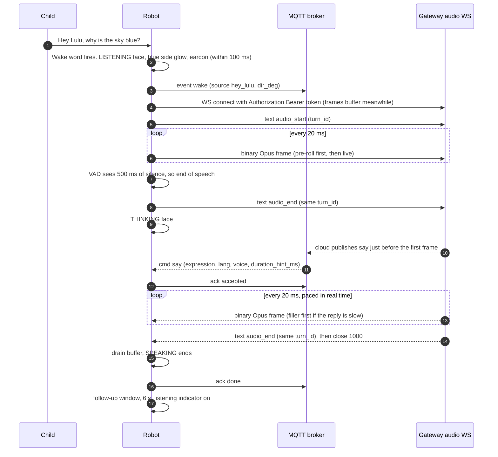
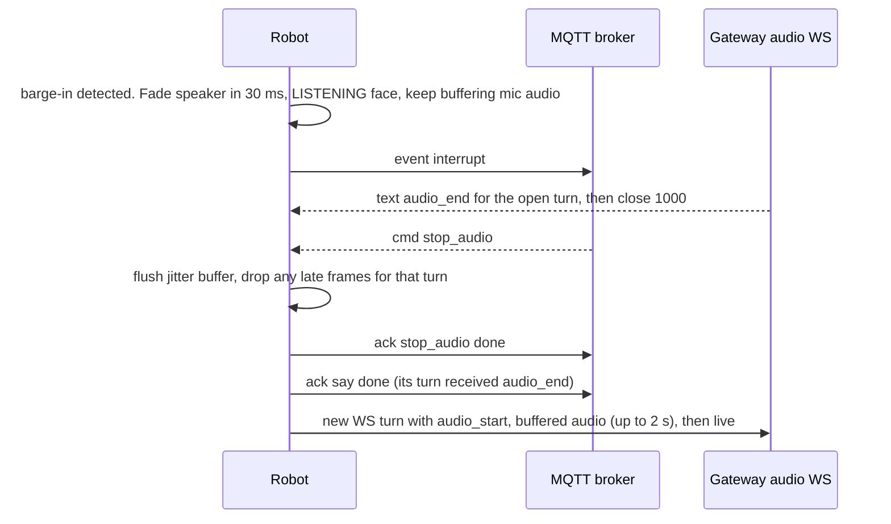
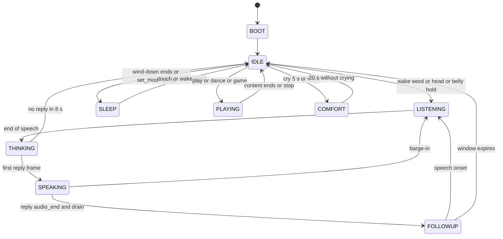

# Xelulu — Firmware Source of Truth

**FW-SOT v1.2 · 2026-10-20 · targets Document B v2 (`proto_ver` 2) + Document C v1.0 · contract snapshot `github.com/vikas-vishw/xelulu@79a92d0`**

This is the one document the ESP32-S3 firmware is built from. If the firmware disagrees with this document, the firmware is wrong. If this document disagrees with Document B or Document C, B/C win and this document gets fixed.

---

## 0. How to read this

**Precedence:** Document B v2 → Document C → this document → everything else. "Everything else" (`Xelulu_Wiring.md`, `Xelulu_Software_Spec.md` v1, `summary.md`, the Eillik docs) is superseded wherever it conflicts with this file. §2.2 lists every conflict.

**Tags used below**
- **MUST / SHOULD**: requirement strength.
- `[CAL]`: a per-robot calibration knob. Never hard-code it. The default lives in `Config.h` and the real value lives in NVS (§14.4). All of them are indexed in §18.
- `[GAP]`: Document B v2 cannot express this. Raise it in Report-Back §7; do not work around it on the wire. The list is in §16.
- `[DECIDE]`: an open decision. A default is given here; §17 lists them all.

### 0.1 This build (confirmed by the hardware lead, 2026-10-20)

**Constraint: no hardware additions.** The firmware adapts to the parts and the wiring that exist (`Xelulu_Wiring.md`). Where physics leaves no firmware fix, this document says so and gives the zero-parts option: a measurement, or moving an existing wire.

| Item | This build |
|---|---|
| Movable joints | **Head pan** (no tilt) · **left arm** · **right arm**: 3 × SC09. The 4th SC09 bought is a spare. |
| Locomotion | **2 wheels** (differential drive) + casters |
| Touch zones | **head, back, belly**, plus **left_hand / right_hand pads (optional)** |
| Ears | **None** (no ear touch, no ear lights) |
| Audio | **2 mics**, **1 speaker** (0.5 W) |
| Distance | **4 × ToF**: 2 looking down for cliffs, 2 horizontal for collisions (front and back) |
| IMU | **10-DoF GY-87** (accel, gyro, compass, barometer) |
| Face | SmartElex 2.0" ST7789 240×320; backlight wired to 3.3 V (always on) |
| Power | 2S pack → BMS → switch → **XY-3606** (one 5.2 V rail for everything) → AMS1117 3.3 V |
| Not fitted | NFC reader, LEDs, head tilt, battery-voltage sensing, charge detection, fuse |

### 0.2 Assumption still open (confirm or correct)

| # | Assumption | If wrong |
|---|---|---|
| A5 | "2 bottom" ToFs = **one at the front edge and one at the rear edge, looking down**. | If both cliff ToFs sit at the rear, forward driving has **no** cliff protection. Then one must move to the front before any wheel test (§11.3). |

### TL;DR: the thirteen rules that matter most

1. **Build to Document B v2 exactly.** Four topics, `proto_ver: 2` on every message, strict JSON with no invented fields, acks with the closed reason list (§4).
2. **No hardware changes.** The firmware uses the existing wiring and parts (§2). §2.6 lists what that rules out and what the firmware does instead.
3. **This build differs from Document B** (5 of 7 touch zones, no NFC reader). Raise G22 before the matrix; never patch it on the wire.
4. **Servos stay on the 5 V rail.** SC09 is rated 4–6 V. The firmware reads each servo's supply voltage at boot and keeps its torque off above 6.2 V (§2.2 #1).
5. **The XY-3606 is rated for 9–36 V in, below the 2S range.** Measure it once (§15 stage 0). The firmware learns where its output starts to sag and treats that as "battery empty" (§11.5).
6. **Listening is always visible.** Whenever mic audio leaves the robot, the face is LISTENING and the screen's side glow is blue. Nothing overrides this (§5.9).
7. **Safety is decided on the robot.** No wheel motion while lifted, near a cliff in the travel direction, in quiet hours, at a low battery, or with movement off. Charging can't be sensed, so charge with the switch off (§12).
8. **One clock for sync.** The speaker's sample clock drives the mouth, the acting cues and the dance beats (§5.11).
9. **One owner per bus.** One task owns I2C, one owns the servo bus, one owns the I2S ports. The render loop never makes a call that can block (this was Eillik's freeze, see `Eillik/debug.md` §1).
10. **Reuse Eillik's 38 faces and 38 sounds unchanged** on a 240×240 canvas centred on the 320×240 panel, and add the 10 Xelulu faces (§9). The side bands carry the light effects.
11. **No head tilt, so the eyes do the vertical looking.** Nods and up/down looks are eye moves plus a small arm bob (§7.1).
12. **Every reaction prints one serial line** (input → face → motion → sound → glow), and every motion prints its measured completion. That log is the acceptance evidence (§14.5).
13. **The minion WAV clips are prototype-only.** Their licence is unknown (§10.3).

---

## 1. What the firmware is

Xelulu is a cloud-brained robot. The ESP32-S3 is a gateway plus a real-time body:

| Concern | On the robot (this firmware) | In the cloud |
|---|---|---|
| Wake word, cry detection, echo cancellation, voice activity, direction of arrival | ✅ | — |
| STT → LLM + safety → TTS | — | ✅ |
| Face, sounds, light effects (on screen), arms, head pan, wheels | ✅ | sends commands only |
| Touch, motion, cliff and collision sensing | ✅ (reacts locally, reports events) | aggregates |
| Physical safety (refusals) | ✅ final say | respects acks |
| Offline play (reactions, copycat, cached songs and stories, comfort) | ✅ | — |

### 1.1 What is reused from Eillik (and what is not)

| Eillik file / idea | Xelulu use | Change |
|---|---|---|
| `EilikFace.cpp/.h`: 38 faces, organic blink, breathing bob, squash/stretch | **Face engine, reused as-is** | Canvas offset to 320×240, +10 faces, mouth-sync overlay, eye-gaze offsets (replace head tilt), screen glows, pixel dimming, photosensitivity fixes, 180° flip (§9) |
| `EilikSound.cpp/.h`: 38 synth effects + boot jingle, clip map, 50 % clip randomiser, raised-cosine edges, `cutFade`, newest-wins | **Sound effects voice of the mixer, reused** | Runs inside the audio task at the same 16 kHz; ambient loops off; +8 new effects; volume curve (§10) |
| `EilikClipsData.h`: 10 WAV clips | **Prototype only** | Licence unknown, replace before any pilot (§10.3) |
| `EilikServos.cpp`: speed×time sequencer for 360° continuous servos | **Not reused** (SC09s are positional with feedback) | Replaced by a keyframe pose engine. The "one motion per face" mapping and the timings are kept (§7.4). Eillik's torso yaw becomes Xelulu's head pan. |
| `EilikMotion.cpp`: IMU on its own task, bus-idle check, plausibility filter, self-motion gate | **IMU module, pattern reused** | Free fall is real now, so a new filter; calibrated mount instead of boot capture; drop/upside-down/spin added; pickup confirmed by cliff ToF (§11.2) |
| `EilikTouch.cpp`: baseline, hysteresis, stuck-pad re-learn | **Logic reused on MPR121** | Hardware baseline tracking; 5 zones (3 + 2 optional hands); tap/double/hold/pat classifier (§11.1) |
| `Eilik_Master_Combo.ino`: `react()`, 5–10 s mood hold, fidgets, 3 random wind-down cycles, wake without a yawn, single `now` per loop | **Behaviour engine, patterns reused** | Retimed for a kids' room; 5-zone trigger map; no anger escalation from touch (§6, §7.5) |
| `Eilik_Bot` serial console ("type 1–38") | **Bring-up console** | Extended to gestures, servos, sensors and the turn (§14.3) |
| `Eillik/debug.md` lessons | **Rules in §2.3, §12 and §15** | I2C wedge, touch thresholds, self-shake loop, cut-off click, `millis()` underflow, shared-rail sag |

---

## 2. Hardware baseline

### 2.1 The build (parts in use)

| Subsystem | Part | Notes |
|---|---|---|
| Brain | ESP32-S3-DevKitC-1 **N16R8** (16 MB flash, 8 MB octal PSRAM) | |
| Face | SmartElex 2" IPS **ST7789P3** 240×320, SPI | BLK on 3.3 V: backlight always on |
| Mics | 2 × GY-**SPH0645LM4H** I2S MEMS | one data line, SEL = left / right |
| Amp + speaker | MAX98357A + 28/30 mm 0.5 W 8 Ω | SD on 3.3 V: amp always enabled |
| Servos | 3 × Waveshare **SC09** (4–6 V, 300°/1024 steps, position/load/speed/voltage feedback); 1 spare | 1 = head pan, 2 = left arm, 3 = right arm; powered from the 5 V rail |
| Drive | 2 × N20 6 V 200 RPM with encoder, 34 mm wheels, 2 casters, TB6612FNG | VM on the 5 V rail, STBY on 3.3 V |
| Touch | Adafruit MPR121 | head, back, belly + optional left/right hand pads |
| IMU | GY-87 10-DoF (MPU6050 used; HMC5883L and BMP180 optional) | §11.2 |
| ToF | 4 × VL53L0X V2 behind a TCA9548A | front + rear collision, front + rear cliff |
| Storage | DFRobot microSD | offline songs, stories, phrases |
| Power | 2 × LG MJ1 (2S), 2S BMS, KCD1 switch, XY-3606, AMS1117-3.3, Type-C 2S boost charger | §2.3 |

### 2.2 What earlier docs got wrong, and the zero-parts answer

| # | Earlier doc said | Fact | What to do (no new parts) |
|---|---|---|---|
| 1 | `Xelulu_Wiring.md` §1d offers "servo VIN = 7.4 V battery" as an option | The SC09 is rated **4–6 V** ([Waveshare SC09 wiki](https://www.waveshare.com/wiki/SC09_Servo)). 8.4 V can destroy it. | Use the other option in the same doc: servo VIN on the 5 V rail. The firmware reads each servo's voltage at boot and keeps that servo's torque off above 6.2 V. This is best-effort, so wire to 5 V. |
| 2 | `Xelulu_BOM_v5_2S.xlsx` (made by Claude) lists the XY-3606 as "7–30 V in" | That spec was wrong. The module is sold as a 12/24 V → 5 V converter (the invoice line reads "24V/12V to 5V"), and listings give **9–36 V in** ([thingbits](https://www.thingbits.in/products/9v-36v-to-5v-5a-dc-fixed-step-down-buck-converter-xy-3606), [grobotronics](https://grobotronics.com/dc-dc-converter-step-down-9-36v-5a.html?sl=en)). A 2S pack is 6.0–8.4 V. | Keep it and measure it once (§15 stage 0). If it holds ≥ 4.9 V under full load from a charged pack, it is usable. The firmware learns the point where the rail starts to sag and treats it as "battery empty" (§11.5). |
| 3 | Servo bus on GPIO 43/44 | Those pins are also wired to the DevKit's USB-serial chip, which can hold GPIO44 and block the bus | The firmware moves logs to the native USB port and pings the servos at boot on 43/44, then on 38/47. If none answer on 43/44, move the two servo wires to GPIO 38/47 (free in your wiring). That is a wire move, not a part. |
| 4 | Document B: 7 touch zones | This build: head, back, belly + optional hands. No ears. | Never emit ear zones (G22) |
| 5 | Review: LEDs for ears, cheeks, belly | No LEDs, no ears | All `led` targets are drawn on screen (§8) |
| 6 | Software Spec v1: `/ota` topic, `say.audio_url`, no `hello`, no `interrupt` | Superseded by Document B v2 | — |
| 7 | Head pan + tilt (FW-SOT v1.0 assumption) | Head pan only | The eyes do vertical looks (§7.1) |
| 8 | `Xelulu_Wiring.md` ToF roles "CH0/CH1 front, CH2/CH3 cliff" | Now front + rear collision, front + rear cliff | The firmware tells cliff from collision sensors at boot (cliff sensors see the floor close up), and `cal tof` labels front/rear once. No rewiring. |
| 9 | Eillik rejected IMU samples below 0.25 g as garbage | Xelulu can be dropped, so free fall is real | New filter (§11.2) |
| 10 | Eillik looped an ambient chirp on SMILE every 2.6 s | It disturbs the wake word and VAD and grates over hours | Off on Xelulu (§10.2) |

### 2.3 Power (as wired)

```
2 × LG MJ1 in series (6.0–8.4 V) → 2S BMS → KCD1 switch → XY-3606 → 5.2 V rail
  5.2 V rail → ESP32-S3 5V pin · MAX98357A · TB6612 VM (motors) · 3 × SC09 · AMS1117
  AMS1117 → 3.3 V → MPR121 · GY-87 · TCA9548A · 4 × VL53L0X V2 · 2 × SPH0645 · TFT (logic + backlight)
                    · microSD · TB6612 VCC and STBY
Charging: Type-C → 2S boost charger → pack. Charge with the switch OFF: the firmware cannot see charging.
```

Everything shares one 5.2 V rail. Eillik showed what that does: servo and motor current dips the rail, which makes the audio crackle and can reset the ESP32. With no extra capacitors or bucks, the firmware manages the load:

| Rule | Value `[CAL]` |
|---|---|
| Soft starts | Wheels ramp at ≤ 0.6 m/s²; servos at the acceleration caps (§7.1) |
| No simultaneous peaks | Never start a wheel move and an arm move of ≥ 90 ° within the same 150 ms |
| Servo torque cap | ≤ 50 % normal, which roughly halves stall current (≈ 0.5 A instead of 1 A each) |
| Audio while driving | Volume −6 dB while the wheels accelerate |
| Brownout watch | Every ESP32 brownout reset is logged. Two within 10 min → low-power mode (no wheels, arm moves at half amplitude) until the next boot with a healthy rail. |
| Peak budget | ESP32 ~0.4 A + amp ~0.5 A + servos ~1.5 A + motors ~1.2 A + 3.3 V loads ~0.3 A ≈ 3.9 A worst case. The XY-3606's 5 A rating is for 9–24 V input; stage 0 measures what it gives from 2S. |

Not a firmware matter, noted once: the BMS trips at 20 A, so a wiring short is not protected by a fuse.

### 2.4 GPIO map (as wired in `Xelulu_Wiring.md`)

| GPIO | Function | Notes |
|---|---|---|
| 8 / 9 | I2C0 SDA / SCL | 400 kHz |
| 4 / 5 / 6 | Mic I2S0 BCLK / WS / DATA | both mics on DATA (SEL GND = left, 3.3 V = right) |
| 15 / 16 / 7 | Speaker I2S1 BCLK / LRC / DIN | |
| 12 / 11 | SPI SCLK / MOSI (no MISO) | display (§9.1) |
| 10 / 14 / 21 | TFT CS / DC / RST | BLK on 3.3 V |
| 48 | SD CS | On DevKitC-1 v1.0 this is also the on-board RGB LED's data pin; that LED may flicker during SD access (harmless) |
| 43 / 44 | Servo bus TX / RX (1 kΩ half-duplex) | Shared with the USB-serial chip (§2.2 #3). Fallback pins: 38 / 47 |
| 1 / 2 / 42 | TB6612 PWMA / AIN1 / AIN2 | left motor |
| 41 / 40 / 39 | TB6612 PWMB / BIN1 / BIN2 | right motor |
| 17 / 18 | Encoder left / right (C1) | PCNT |
| 38 / 47 | spare | fallback servo bus |
| STBY | 3.3 V | The firmware stops the motors through the IN pins (short brake) |
| — | No battery-voltage pin | §2.6 |

| MPR121 electrode (as wired) | Zone |
|---|---|
| ELE0 | head |
| ELE1 | back |
| ELE2 | belly |
| ELE3 | left_hand (if `HANDS_FITTED`) |
| ELE4 | right_hand (if `HANDS_FITTED`) |

The electrode map is `TOUCH_ELE_MAP` `[CAL]`, so a rewired pad never needs a code change.

Firmware pin rules:
- Logs go to the native USB port ("USB CDC on boot"), so the UART0 pins (43/44) are free for the servo bus.
- The first thing `setup()` does is drive all six motor pins low. STBY is tied high, so this is what keeps the wheels still during boot.

### 2.5 Buses

**I2S: two ports, as wired.**
- **I2S0 RX (mics):** 16 kHz, 32-bit slots, stereo, Philips format, 10 ms DMA blocks. Take the upper 18 bits (`sample >> 14`), then scale to int16. Verify with a 1 kHz tone; if the samples look bit-shifted (heavy DC offset or distortion), try MSB format, a known SPH0645 quirk on ESP32.
- **I2S1 TX (speaker):** 16 kHz, 16-bit stereo (the same mono sample on both slots, as Eillik does). MAX98357A GAIN floating = 9 dB.
- Both ports run from the same clock source at the same rate, so they never drift apart. The fixed offset between them is measured once (`AEC_REF_DELAY_MS` `[CAL]`) for the echo canceller (§5.1).

**I2C0, 400 kHz, owned exclusively by the Sense task (§3.3).**

| Address | Device | Path |
|---|---|---|
| 0x5A | MPR121 | main bus |
| 0x68 | MPU6050 (GY-87) | main bus |
| 0x1E | HMC5883L compass (GY-87) | behind the MPU's I2C bypass; enable the bypass only if the compass is used |
| 0x77 | BMP180 barometer (GY-87) | main bus |
| 0x70 | TCA9548A | main bus |
| 0x29 | 4 × VL53L0X | mux CH0–CH3; roles from `TOF_CH_MAP` `[CAL]` (§11.3) |

Pull-ups: each breakout carries its own, so measure the parallel value on SDA/SCL (about 2.2–4.7 kΩ is right). If a VL53L0X does not answer at 0x29 on its channel, check its wiring and that XSHUT is not held low.

**SPI2, shared by the TFT and the SD card.** TFT at 40 MHz, raise to 80 MHz if the panel tolerates it `[CAL]`. SD at 20 MHz. One SPI mutex. The SD reader works in 8 KB chunks into a PSRAM ring, so it can wait out one frame push (≤ 25 ms) without an audio underrun.

**UART servo bus.** 1 Mbps, half-duplex, SCS protocol (Waveshare/Feetech `SCServo` library, `SCSCL` class).
- **Level check before trusting RX:** with one SC09 powered from the 5 V rail, measure its signal line idle voltage. ≤ 3.6 V is fine for the ESP32-S3. Above 3.6 V the RX pin is over its rating; tell me and the firmware will switch to a write-only bus without feedback.
- **IDs:** 1 = head pan, 2 = left arm, 3 = right arm (as wired). Factory default is ID 1, so assign them one at a time before chaining. Keep the spare out of the robot and program it to the ID it replaces.
- **Pin auto-detect:** at boot the firmware pings IDs 1–3 on GPIO 43/44, then on 38/47, and uses the pair that answers. It logs which pair it chose.

**PCNT:** encoder rising edges. **LEDC:** motor PWM 20 kHz (inaudible).

### 2.6 What firmware cannot do with this hardware (and what it does instead)

| Feature | Limit | Firmware does |
|---|---|---|
| Battery % | No battery-voltage divider | A coarse level from the 5 V rail. The SC09s report their supply voltage, and it sags as the pack nears the XY-3606's dropout. Reported as 80 / 20 / 10 / 5 % (§11.5). |
| Charging detection | No charger signal | `charging` is always `false`. Rule: charge with the switch off. |
| Backlight dimming | BLK on 3.3 V | Dims by pixel brightness. In sleep, the panel's display-off command shows black (the backlight stays lit). |
| Speaker mute | SD on 3.3 V | Stops I2S1 in sleep, so the amp idles silent |
| NFC story cards | No reader | `nfc` is never sent; story cards and treasure hunt are unavailable (G22) |
| Physical lights | No LEDs | Drawn on screen (§8) |
| Loud, full stories | 0.5 W speaker | Full scale is the ceiling (§10.4) |
| Rail sag protection | One shared rail, no extra capacitance | Load management (§2.3) |

---

## 3. Firmware platform

### 3.1 Toolchain (pin exact versions in the firmware repo)

| Item | Choice | Why |
|---|---|---|
| Core | **Arduino-ESP32 3.3.10** (ESP-IDF 5.x underneath) | Same core as Eillik's verified build (`debug.md`) |
| Board | ESP32S3 Dev Module · Flash 16 MB QIO · PSRAM: OPI · USB CDC on boot: enabled · custom partitions (§3.4) | |
| Starting point | ElatoAI `firmware-arduino` (MIT; keep the notice) for WSS + Opus + OTA | Document B §9 Q2 |
| Display | TFT_eSPI with an 8-bit sprite (as Eillik) | If `tft.init()` crashes on S3 + core 3.x, add `#define USE_HSPI_PORT` (community workaround). LovyanGFX is the fallback. |
| Audio front end | ESP-SR (bundled with the core for S3): AFE (AEC, BSS/NS, VAD) + WakeNet. Flash the model partition. | §5.10 |
| Codec | libopus Arduino port (e.g. `pschatzmann/arduino-libopus`) | 16 kHz mono, 20 ms |
| MQTT | ESP-MQTT (IDF client: async, QoS 1, TLS, reconnect). MQTT 5 if the core's sdkconfig enables it, else 3.1.1 `[GAP G11]` | |
| WebSocket | arduinoWebSockets (links2004) or `esp_websocket_client` | Needs a custom `Authorization` header, no compression extension |
| JSON | ArduinoJson 7, fixed-size documents, no `String` churn | |
| Servos | Waveshare/Feetech `SCServo` (`SCSCL`) | |
| Sensors | Adafruit_MPR121, Pololu VL53L0X | |
| Wake word (phase B) | microWakeWord (TFLite Micro) for "Hey Lulu" | openWakeWord is too heavy for an MCU |

### 3.2 Module map

```
xelulu_fw/
  xelulu_fw.ino     setup(); loop() = behaviour engine + face render (core 1, loopTask)
  Pins.h            §2.4: the ONLY file where GPIO numbers appear
  Config.h          compile-time defaults for every [CAL] knob (runtime values live in NVS)
  Contract.h        every Document B string and enum, copied from packages/shared/.../enums.ts @79a92d0
  net/      Wifi · Mqtt (topics, outbox, acks, idempotency) · Clock (SNTP, time_uncertain)
  audio/    AudioIO (I2S0 in + I2S1 out) · Afe · Turn (WS state machine) · Opus · Mixer · Sfx (EilikSound port)
            · Player (SD Ogg-Opus + cues) · Copycat · Cry · Doa
  face/     Face (EilikFace port + new faces + mouth overlay + eye gaze) · Glow (screen light effects)
  body/     Body (servo bus, trajectories, poses, gestures) · Drive (motors, PCNT, PI, odometry) · Safety (interlocks)
            · Power (rail voltage, brownout watch, load management)
  sense/    Sense task: Touch (MPR121) · Imu · Tof (mux)
  behavior/ Reactions (§7 tables as data) · Idle/decay · Modes · Games
  store/    Settings (NVS) · Calibration (NVS) · Content (SD manifest) · EventQueue
  ota/      Ota (manifest, download, verify, rollback)
  console/  Serial bring-up console (§14.3)
```

**Body module API.** Today it is a FreeRTOS queue.
- Commands in: `pose(targets, ms, ease)`, `gesture(id, priority, src_cmd_id)`, `drive(v_mms, w_mrad_s, dist_mm)`, `stop(reason)`, `torque(joint, pct)`, `limp()`.
- Events out: `gesture_done(id, ok, err_deg)`, `drive_done(ok, dist_mm)`, `interlock(reason)`, `fault(code)`, `arm_load(joint, pct)`, `rail_mv(mv)`.

### 3.3 Tasks and cores

| Task | Core | Priority | Rate | Owns |
|---|---|---|---|---|
| `audio_io` | 1 | 22 | DMA-paced, 10 ms | I2S0 RX + I2S1 TX, AEC reference ring |
| `body` | 1 | 21 | 100 Hz | servo bus, motors, PCNT, safety interlocks, rail voltage |
| `afe_feed` / `afe_fetch` | per ESP-SR guidance (feed and fetch on different cores) | 20 / 19 | 32 ms chunks | AFE, wake word, VAD, cry |
| `opus_dec` | 1 | 18 | 20 ms | jitter buffer → PCM ring |
| `sense` | 0 | 17 | 100 Hz IMU, 50 Hz ToF/touch | **I2C0 (exclusive)** |
| `opus_enc` + WS TX | 0 | 15 | 20 ms | encoder, WebSocket send |
| `net` | 0 | 12 | event-driven | ESP-MQTT, WS RX, outbox |
| `sd_reader` | 0 | 10 | on demand | SD (shares the SPI mutex) |
| `housekeeping` | 0 | 5 | 100 ms | status heartbeat, NVS, battery estimate, faults |
| `ota` | 0 | 3 | on demand | |
| `loopTask` | 1 | 1 | ~33 ms | behaviour engine, face + glow render and push |

The task watchdog covers `body`, `sense`, `audio_io` and `loopTask`. Shared state moves through queues or under short mutexes; nothing in an ISR beyond setting a flag.

### 3.4 Flash partitions (16 MB)

| Name | Size | Holds |
|---|---|---|
| nvs | 24 KB | settings, calibration, identity, queued cry events |
| otadata + phy | 12 KB | |
| ota_0 | 4 MB | app |
| ota_1 | 4 MB | OTA slot (rollback) |
| model | 3 MB | ESP-SR models |
| littlefs | ~4.9 MB | WAV clips, fallback phrase set, default cue files |
| coredump | 64 KB | crash dumps (never audio) |

### 3.5 Budgets (targets; measure at bring-up)

| Resource | Allocation target |
|---|---|
| Internal SRAM (512 KB) | Wi-Fi/LwIP ~80 KB · face sprite 240×240×8-bit = 57.6 KB · task stacks ~60 KB · I2S DMA ~16 KB · Opus enc+dec ~50 KB · mbedTLS → **put in PSRAM** · rest headroom ≥ 60 KB |
| PSRAM (8 MB) | AFE + WakeNet ~1.5–2 MB · jitter/PCM rings 256 KB · SD ring 64 KB · pre-roll 32 KB · copycat 160 KB · cue tables |
| Core 1 | face ~50 % at 30 fps (Eillik measured 32 ms/frame on the older ESP32 at 40 MHz SPI) · audio I/O + decode + mix ~15 % · body ~3 % |
| Core 0 | Wi-Fi/TLS ~20 % · AFE + wake ~40 % · Opus encode ~15 % · sensors ~5 % |

If over budget, degrade in this order: face 30 → 20 fps · Opus complexity 3 → 1 · BSS off (single mic + AEC) · cry detector paused during turns.

---

## 4. Wire contract implementation (Document B v2 + Document C)

### 4.1 Identity and endpoints

Four values live in NVS. Set them over the serial console in the prototype (Document C Part 1, provisioning, is not specified yet):

| Key | Dev value | Production |
|---|---|---|
| `DEVICE_ID` | `xlu_000123` | cloud-issued |
| `DEVICE_TOKEN` | dev placeholder | per-device key in ESP32-S3 secure storage |
| `MQTT_BROKER_URL` | `mqtt://<LAN-IP>:1883` | `mqtts://…:8883` |
| `AUDIO_WSS_URL` | `ws://<LAN-IP>:8081` | `wss://…` |

Wi-Fi credentials are stored the same way. Logs print the token as `set` or `not set`, never its value.

### 4.2 Connection sequence (every connect and every reconnect)

1. Connect to MQTT with **client id = `device_id`**, username = `device_id`, password = `DEVICE_TOKEN`, clean start.
2. Subscribe to `xelulu/{device_id}/cmd` at QoS 1, and nothing else.
3. On SUBACK, publish `hello` on `…/status` at QoS 1.
4. Publish a `status` immediately, then every **15 s** (QoS 0).
5. Replay the offline queue (§4.5). After that, publish events live.
6. Reconnect backoff: 1 → 2 → 4 → 8 → 16 → 30 s, ±20 % jitter. On an auth refusal, back off 60 s and show nothing scary; Document C forbids a tight retry loop.
7. On boot, print `device_id` and `fw_ver` on the serial console so the operator can compare the console's pairing code (Document C §2.2).

Document B §2's narrative lists `hello` before subscribing and also subscribes to `/ack`. Document C §2.1 and the integration guide §9.4 fix **subscribe(`cmd`) → `hello`**, and the console checks that order. Follow C. `[GAP G20]`

### 4.3 Upstream messages (exact shapes)

Every upstream message carries `proto_ver: 2`, `ts` (unix **seconds**, integer) and `type`. No other keys are allowed.

```json
{"proto_ver":2,"ts":1733400000,"type":"hello","device_id":"xlu_000123","fw_ver":"0.1.0","auth":"<token>","proto":2}
{"proto_ver":2,"ts":1733400000,"type":"status","battery_pct":80,"charging":false,"mode":"idle","wifi_rssi":-58,"fault":[],"active_child_id":"c_01","temp_c":31}
{"proto_ver":2,"ts":1733400001,"type":"event","event_id":"ev_…","event":"touch","data":{"zone":"belly","gesture":"double_tap"}}
{"proto_ver":2,"ts":1733400005,"type":"ack","cmd_id":"9f2c","status":"done","reason":""}
{"proto_ver":2,"ts":1733400001,"type":"audio_start","turn_id":"t_…"}      (WS text frame)
{"proto_ver":2,"ts":1733400004,"type":"audio_end","turn_id":"t_…"}        (WS text frame)
```

- `battery_pct` is the coarse estimate from §11.5. `charging` is always `false` on this hardware (§2.6).
- `active_child_id` is a string or `null` (last `config`, from NVS).
- `temp_c` is the ESP32-S3 internal sensor reading.
- `mode` is one of `idle, play, story, quiet, sleep` (§6.3).
- `time_uncertain` is optional on events: `true` only for an event generated **before the first SNTP sync since boot** (§4.4).

### 4.4 IDs and time

- `event_id` = `"ev_"` + 16 random bytes in base64url (22 characters). `turn_id` = `"t_"` + the same. Both use the hardware RNG and mirror the simulator.
- Run SNTP on every connect. Save the epoch to NVS every 10 min. Until the first sync after boot, `ts` = last saved epoch + uptime, and events carry `time_uncertain: true`.

### 4.5 Outbox and offline queue

- Events go out at QoS 1, **one in flight at a time**, and leave the queue only on PUBACK. This preserves order (same as the simulator's outbox).
- Offline queue: 500 events in RAM; when full, drop the oldest. **Cry events are also written to NVS** (max 20) until PUBACKed, so a parent alert survives a reboot or a flat battery.
- Replay happens after `hello` + the first `status`. Replayed events keep their original `event_id`, `ts` and `data`.

### 4.6 Command intake rules

| Case | Firmware does |
|---|---|
| Not JSON, `proto_ver` ≠ 2, or missing/empty `cmd_id` | No ack, nothing applied. Log it. Add `proto_mismatch` or `cmd_invalid` to `status.fault` for 60 s (Document B: keep the last-known-good state, report, do not act). |
| Valid envelope, unknown `action` | `ack rejected / unknown_action` (Document B §5, guide §9.3). The simulator currently answers nothing here `[GAP G21]`. |
| Known action, `data` has a missing, extra or mistyped field | No ack, log, fault `cmd_invalid` (mirrors the simulator; the cloud's 10 s `no_ack` surfaces it) |
| `cmd_id` already seen (ring of the last **1000**) | Re-publish the acks already sent, in order. Apply nothing. |
| Valid | Dispatch per §4.7 |

Ack timing: the cloud marks `no_ack` after 10 s and `no_completion` after 60 s without a terminal ack. `accepted` goes out within 50 ms of receipt. Ack reasons are final: the cloud never retries around them.

### 4.7 Per-command behaviour and acks

Refusal reasons: `picked_up, at_edge, charging, quiet_hours, low_battery, unsafe, busy, unknown_action`. A `rejected` ack **must** name one. (`charging` is never used on this hardware; it cannot be sensed.)

| Action | Device does | Ack sequence | Device refusals (`rejected`) |
|---|---|---|---|
| `say` | **Turn open:** pair it with the open turn and apply the expression map (§9.3), the speaking overlay, and the grandma style if `voice=grandma`. **No turn open:** `[GAP G1]` fallback, i.e. the expression + matching sound effect for min(`duration_hint_ms`, 5 s). | `accepted` now → `done` after the turn's downstream `audio_end` + buffer drained. `failed ""` if the socket closes without `audio_end`. | Outside a turn only: `quiet_hours`. `busy` if the child is mid-upload. |
| `animate` | Face per §9.3 (`eyes` may override; `loop` = hold until changed) | `accepted` → `done` once applied | none |
| `gesture` | Gesture library §7.3 | `accepted` at start → `done` when the last keyframe is reached **and** feedback is within ±5 ° within 300 ms. Else `failed ""`. Unknown name → `failed ""`. | `picked_up`, `at_edge` (≤ 3 s after a cliff), `quiet_hours`, `low_battery` (estimate ≤ 10 %), `busy` (another cloud gesture or dance running), `unsafe` (servo fault, low-power mode) |
| `move` | §7.7 | `accepted` → `done` on completion; `failed ""` on stall or abort | `picked_up`, `at_edge`, `quiet_hours`, `low_battery`, `unsafe` (`movement_on=false`, tilted, sensor stale, 3 m tether exceeded, MQTT down, low-power mode), `busy` (dance running). `stop` is always accepted. |
| `play` | `source=cache`: Ogg-Opus from SD with an optional cue file (§13.2), or a reserved local game id (§7.8). `bringup_probe` → built-in boot jingle. `source=stream` → `[GAP G2]`. | `accepted` → `done` **when playback starts** `[GAP G3]`. `failed ""` if the content is missing or `source=stream`. | `quiet_hours` (unless a child interaction happened in the last 2 min), `busy` (mid-upload) |
| `set_mode` | §6.3 | `accepted` → `done` | none |
| `led` | Drawn on screen (§8): `ears` + `belly` as side glows, `cheeks` as blush. Ear glow is deferred while the listening indicator is on. | `accepted` → `done` | none (caps applied silently) |
| `volume` | Gain curve §10.4 + a confirmation chirp (not in quiet hours) | `accepted` → `done` | none |
| `config` | Persist any subset of `volume`, `quiet_hours`, `movement_on`, `language`, `active_child_id` to NVS | `accepted` → `done` | none |
| `stop_audio` | Fade 8 ms, flush the jitter buffer, cancel the pending `say` | `accepted` → `done` (also when nothing is playing) | none |
| `ota` | §13.4 | `accepted` → `done` after the image is verified and staged (before reboot); `failed ""` on error | `low_battery` (estimate below 80 %, i.e. the rail has started to sag), `busy` (turn, move or play in progress) |

### 4.8 Events: when the firmware emits each, and what `data` means

| `event` | Emitted when | `data` |
|---|---|---|
| `touch` | Each classified touch (§11.1) | `zone`: `head`, `back`, `belly`, and `left_hand`/`right_hand` when fitted. **Never `left_ear`/`right_ear`** (no ears, G22). `gesture`: `tap`, `double_tap`, `hold`, `pat` |
| `wake` | Wake word, or a head/belly hold ≥ 1 s | `source` `hey_lulu`/`touch`; `dir_deg` integer 0–359, **0 = straight ahead, increasing counter-clockwise (robot's left)** `[GAP G6]`; omitted if unknown |
| `cry` | Crying sustained ≥ 5 s with confidence ≥ 0.7 `[CAL]`; again every 60 s while it continues | `confidence` 0–1, `duration_s` (cumulative). No audio, ever. |
| `motion` | §7.5.2 | `event` `pickup`/`shake`/`upside_down`/`drop`/`tilt`; `value` is one number, units per kind: pickup = peak vertical g · shake = peak g · upside_down = degrees from upright · drop = free-fall ms · tilt = degrees `[GAP G5]` |
| `button` | Belly hold ≥ 1 s → `press`; lift → `release` | `button: belly_talk`, `action` |
| `nfc` | **Never on this hardware** (no reader, G22) | — |
| `interrupt` | Barge-in detected (§5.5) | `{}` |
| `error` | A **new hardware fault**, once per fault per boot. It moves the console session to Error, so use it sparingly. | `code` = fault code, `detail` = short non-personal text |

`status.fault[]` codes: `imu_missing, touch_missing, tof_front_missing, tof_rear_missing, cliff_front_missing, cliff_rear_missing, servo_1_missing … servo_3_missing, servo_N_overvolt, servo_N_overload, servo_N_overheat, motor_l_stall, motor_r_stall, encoder_l_dead, encoder_r_dead, sd_missing, sd_error, i2c_bus_stuck, mic_silent, rail_low, brownout_reset, low_power_mode, proto_mismatch, cmd_invalid`.

### 4.9 The 28-row test matrix: what the firmware must do

| Row(s) | Expected | Firmware behaviour that makes it pass |
|---|---|---|
| `say` | ack done/accepted | The probe arrives with no turn open → G1 fallback: SMILE + S_SMILE for 1.2 s → `accepted`, `done` |
| `animate` | ack | `happy` + `blink` → SMILE, one blink → `done` |
| `gesture` | ack | `wave` (§7.3) → `done` with feedback OK |
| `led` | ack | `ears #2244aa solid 40` → blue upper side glow on screen → `done` |
| `play` | ack | `bringup_probe` + `cache` → boot jingle → `done` |
| `move`, `set_mode`, `volume`, `config`, `stop_audio`, `ota` | refused by the console gate | Nothing reaches the robot; still implement each per §4.7 |
| `touch`, `head`, `back`, `belly` | green | Touch that zone (§7.5.1) |
| `left_hand`, `right_hand` | green if the hand pads are fitted | Touch that hand. Without pads → record **N/A (hardware)** |
| `left_ear`, `right_ear` | **cannot go green from this robot** | No ears. Fire them from the simulator panel; record **N/A (hardware), G22** on the robot run |
| `nfc` | **cannot go green from this robot** | No reader. Fire it from the simulator panel; record **N/A (hardware), G22** |
| `wake` | green | "Hey Lulu" or a belly hold |
| `cry` | green | Cry detector ≥ 5 s (bench: play a cry recording) |
| `motion` | green | Pick up, shake or tilt |
| `button` | green | Belly hold ≥ 1 s → `press` |
| `interrupt` | green | Speak over a reply |
| `error` | green | Unplug a servo, then reboot |
| `audio_turn` | green | Hold the belly and say one sentence |
| `safety_refusal` | green | Lift the robot, Run `gesture` → `rejected / picked_up` |

---

## 5. Voice: how the mic is processed and how robot speech is streamed

### 5.0 In one paragraph

Conversation and storytelling use **the same audio path**. A per-turn WebSocket carries Opus at 16 kHz mono in 20 ms frames, both directions. The child's audio goes up; the cloud's voice (Xelulu, or Grandma for stories) comes down, paced in real time. A `say` command on MQTT tells the robot which face to wear while it speaks. The robot plays the audio, drives the mouth from that same audio, and acts with its head and arms. Long cached songs and stories play from microSD.

Three things are **not possible in `proto_ver` 2** and must be raised (§16):
1. Speech the cloud starts on its own (routines, reminders, walkie-talkie, Grandma recordings, live calls): G1.
2. Streamed `play`: G2.
3. Fine acting cues inside a streamed reply: G17.

### 5.1 Mic pipeline

```
2 × SPH0645 ──I2S0 RX (16 kHz, 32-bit, L/R)──► audio_io ──► int16 L, R ─┬─► DOA (GCC-PHAT on raw L/R) → dir_deg
                                                ▲                        │
speaker samples (I2S1 TX, same clock source) ───┘ reference ring ────────┤
                                                                          ▼
                                     ESP-SR AFE input "MMR" (mic, mic, reference)
                                     AEC → BSS/NS → AGC → VAD → single clean channel
                                                                          │
                     ┌────────────────────────┬───────────────────────────┼─────────────────────────┐
                     ▼                        ▼                           ▼                         ▼
               WakeNet / microWakeWord   cry detector (idle)       pre-roll ring (300 ms)     Opus encoder (in a turn)
                     │                        │                           └──────────┬──────────────┘
                 wake event               cry event                            WS binary frames
```

| Parameter | Value |
|---|---|
| Capture | 16 kHz, 32-bit slots, stereo; 18 valid bits → int16 with digital gain `MIC_GAIN_DB` `[CAL]` (default +12 dB; the SPH0645 is −26 dBFS at 94 dB SPL) |
| AEC reference | The exact samples written to I2S1, delayed by `AEC_REF_DELAY_MS` `[CAL]` (measure once with a click: the fixed offset between the two ports plus the acoustic path) |
| DOA | 2 mics give azimuth −90…+90 ° with front/back ambiguity, about ±15 ° accuracy. Mic spacing `MIC_SPACING_MM` `[CAL]`. If the mics sit on the head (`MICS_ON_HEAD` `[CAL]`), add the current head-pan angle to get a body-relative direction. |
| Encoder | Opus, `VOIP` application, 16 kHz mono, **20 ms = 320 samples**, VBR 24 kbps, complexity `OPUS_COMPLEXITY` `[CAL]` (default 3), **one Opus packet per WS binary message**, ≤ 1500 bytes (gateway limit) |
| Privacy | Audio leaves only inside a turn. The pre-roll ring lives in RAM and is overwritten every 300 ms. Nothing is written to flash or SD, or logged. |

### 5.2 A conversation turn



**Turn state machine:** `IDLE → CONNECTING → UPLOADING → WAITING → PLAYING → DRAINING → FOLLOWUP → IDLE`, with `ABORTED` reachable from any state. One turn at a time. A wake word while UPLOADING is ignored; a wake word while PLAYING is a barge-in (§5.5).

**Pairing `say` with the audio.** They arrive on two different sockets.
- If frames arrive first, start playback on the current face with the speaking overlay, and apply the expression when the `say` lands.
- If the `say` arrives first, hold its expression until the first frame, or 3 s, whichever comes first.

### 5.3 Endpointing and timeouts

| Rule | Value |
|---|---|
| Wake word → stream starts | From the detection point, with 300 ms pre-roll `PREROLL_MS` `[CAL]` |
| Push-to-talk (head or belly hold ≥ 1 s) | Upload starts at the hold threshold. If still held when speech stops, wait for release (max `PTT_MAX_MS` 15 s). If released before speaking, switch to VAD endpointing. **Offline, the same hold starts copycat instead** (§7.8). |
| End of speech (VAD) | `VAD_TAIL_MS` 500 ms `[CAL]` of silence after ≥ 250 ms of speech |
| No speech after wake | 4 s → close the turn quietly (send `audio_end` only if `audio_start` was sent) |
| Max upload | 55 s (gateway hard limit 60 s / 3000 frames) |
| `audio_start` deadline | ≤ 5 s after the socket opens (gateway `start_timeout`). Send it as soon as the socket is up. |
| Reply wait | No first frame 8 s after `audio_end` → abandon: close the WS, THOUGHTFUL → POUT-lite, phrase `star_library_slow` |
| Turn socket | The gateway closes it with 1000 after the reply's `audio_end`. A new turn always opens a new socket. |

### 5.4 Playback (cloud voice down to the speaker)

```
WS binary ─► jitter buffer (PSRAM) ─► Opus decode 16 kHz ─► PCM ring ─► Mixer ─► volume ─► I2S1 TX ─► MAX98357A
                                                                         ▲   ▲
                                                Sfx (Eillik synth + clips)   Player (SD Ogg-Opus)
```

| Parameter | Value |
|---|---|
| Jitter buffer start | 4 frames = 80 ms, or 150 ms after the first frame `[CAL]` |
| Jitter buffer max | 400 ms (drop the oldest beyond that) |
| Late or missing frame | Opus packet-loss concealment for up to 3 frames (60 ms), then silence; resume without a click |
| Mixer channels | Stream (voice, story, music), SFX. While the stream plays, SFX is ducked −12 dB, and only earcons are allowed. |
| Cut-off | Eillik `cutFade`: 8 ms ramp to zero on any stop |
| Rate | Everything is 16 kHz end to end (Eillik's SFX already is), so there is no resampling |

### 5.5 Barge-in (the child talks over Xelulu)

Detection while PLAYING (any one is enough):
- VAD on the AEC output sees child speech ≥ 300 ms with energy ≥ `BARGEIN_MARGIN_DB` `[CAL]` above the echo residual.
- The wake word.
- A tap on the head or belly.



The robot opens the new socket only after the old turn's `audio_end`, its close, or `stop_audio` (1.5 s timeout). Opening it earlier would "replace" the old turn in the gateway and skip the Document B sequence. The child's words are not lost, because they are buffered.

### 5.6 Follow-up window (answers without "Hey Lulu")

Replies always end with a question (XL-V02), and stories branch on the child's answer (XL-G02). So after every reply, the mic stays armed for `FOLLOWUP_MS` = 6 s (8 s when `voice=grandma`) `[CAL]`.
- During the window: LISTENING-lite face and a 30 % blue side glow, so the robot visibly is listening.
- The upload starts only at speech onset (with pre-roll). No speech, no upload, and the window closes.

### 5.7 Storytelling: three paths

| Path | Used for | How it flows | How Xelulu acts |
|---|---|---|---|
| **A. Interactive story by voice** (works today) | Grandma stories, branching (XL-G01/G02) | The cloud's story session speaks each step as a normal turn reply with `say.voice = grandma`. The child's answer (in the follow-up window) is the next turn. | STORYTELLER presentation (§9.2 #43): amber belly glow, slow head sway, larger arm beat gestures, mouth sync. `say.expression` sets the mood per step. Finer cues need `[GAP G17]`. |
| **B. Cached story or song** (`play`, `source: cache`) | Offline library (30 songs + 30 stories), bedtime, dances | Ogg-Opus from SD plus an optional cue file (§13.2) | Cue file drives faces, gestures, glows and dance patterns on the audio clock (§5.11) |
| **C. Cloud-pushed audio** | Grandma recordings, live Grandma, walkie-talkie, routine narration | **No audio path in `proto_ver` 2** `[GAP G1, G2]` | Interim: expression + sound effect only |

### 5.8 Latency budget

| Segment | Owner | Target |
|---|---|---|
| Wake word heard → LISTENING face + earcon | device | ≤ 100 ms after detection |
| Wake → WS connected | device | ≤ 600 ms with TLS (≤ 100 ms on the LAN dev stack). Audio is buffered, so nothing is lost. |
| End of speech → `audio_end` sent | device | `VAD_TAIL_MS` 500 ms (push-to-talk release ≤ 40 ms) |
| `audio_end` → first reply frame | cloud | Typical ≤ 0.4 s, worst ≤ 1.0 s. The cloud filler starts at 600 ms. |
| First frame → audible | device | ≈ 110 ms (80 ms jitter buffer + decode/mix/DMA) |
| **End of child's speech → first audio** | both | **1.0 s typical / 1.6 s worst** (product.md) |

The device spends about 0.6 s of the 1.0 s, so the cloud has about 0.4 s. That is tight for real providers (ElatoAI's baseline is 2–3 s). Two levers exist: shrink `VAD_TAIL_MS` to about 350 ms once a semantic endpointer exists, and show THINKING instantly so the wait feels intentional.

### 5.9 Privacy rules enforced on the device

1. Mic audio leaves the robot only inside an audio turn: after a wake word, a head/belly hold, a follow-up onset, or a barge-in.
2. **Whenever audio is leaving, LISTENING is on screen and the side glow is blue (`#2D7DFF`, 60 %).** Cloud `led` commands to the `ears` target are deferred until the upload ends; `animate` cannot hide it.
3. No audio is ever written to flash, SD, NVS, logs or crash dumps. Copycat recordings stay in RAM and are wiped after playback.
4. `cry` sends only `confidence` and `duration_s`.
5. Serial logs carry ids, enums, counts and times only. That matches the cloud's rule and the Report-Back privacy rule.

### 5.10 Wake word and cry detection plan

| Stage | Wake | Cry |
|---|---|---|
| Bring-up | Push-to-talk only (head/belly hold) plus an ESP-SR built-in word (e.g. "Hi ESP") as a stand-in to test AEC and the pipeline | Energy-plus-harmonicity heuristic, marked **not for release** |
| P0 | Custom **"Hey Lulu" / "Xelulu"** with microWakeWord, trained on synthetic plus child voices. Espressif's paid custom WakeNet is the alternative. | TinyML classifier on 1 s windows (log-mel input, int8), trained on infant-cry data. Event when the 5 s average ≥ 0.7. |
| Always | Wake word is off in quiet hours (XL-C06) | Runs when no turn is open; never sends audio |

### 5.11 Runtime sync: making sound, face and body happen together

1. **One master clock.** The I2S1 TX sample counter. `playhead_ms = samples_played / 16`. Every audio-tied action is scheduled against it, never against `millis()`.
2. **Mouth sync.** The mixer computes an envelope (attack 15 ms, release 90 ms, gate −45 dBFS) per 10 ms block, *ahead of playback* from the PCM ring. The face draws the envelope of the audio that will be heard when the frame appears (look-ahead = I2S DMA ≈ 20 ms + frame latency ≈ 25 ms). So the lips land on the sound, and there is no drift because both come from the same samples.
3. **Lead compensation.** A cue at content time `t` fires at `playhead ≥ t − lead`: face `FACE_LEAD_MS` 25, glows `GLOW_LEAD_MS` 10, servos `SERVO_LEAD_MS` 80 `[CAL]` (servos are slower than pixels).
4. **Head first** (Eillik body datasheet): for reactions the head pan moves at 0 ms, the face changes at +100 ms, and the arms start at +225 ms. For audio cues all three are pre-shifted so they land together.
5. **Speech body layer.** While speaking, the eyes bob ±2 px with the envelope (low-passed at 4 Hz) and the head sways ±2 ° in pan at ≤ 0.3 Hz. Beat gestures lift an arm 12 ° on envelope peaks, at least 600 ms apart, alternating arms. With no head tilt, the eyes carry the "nodding along".
6. **MQTT-timed commands** (`animate`/`gesture` sent mid-reply) execute on arrival (20–150 ms network jitter). That is fine for gestures and wrong for lip-sync, which is why the mouth is local.
7. **One body arbiter** (§6.2) sums the base pose and the additive layers, clamps to soft limits, then rate-limits to speed caps. Nothing writes to a servo directly, so two behaviours can never fight.
8. **Physical truth.** A gesture is `done` only when SC09 feedback confirms the pose (±5 °), and a drive is `done` only when encoders confirm the distance.

---

## 6. Behaviour engine

### 6.1 States



`QUIET` and `LOW_POWER` are overlays that clamp volume, glows and motion in any state. `LIFTED`, `AT_EDGE` and `FAULT` are safety overlays (§12).

### 6.2 Priority arbiter (who owns face, sound and body)

| Level | Owner | Face | Sound | Body |
|---|---|---|---|---|
| P0 | **Safety** (cliff, lifted, drop, stall, rail sag) | may override (SCARED) | may override | **stops wheels; may limp servos** |
| P1 | **Privacy indicator** (audio leaving) | LISTENING + blue glow enforced | earcon | — |
| P2 | **Voice turn** (listening, thinking, speaking) | owns | owns stream | speech layer only |
| P3 | **Cloud command** (`gesture`, `animate`, `play`, `move`) | `animate`/`say` set it | `play` owns stream | owns while running |
| P4 | **Local reflex** (touch, IMU reactions) | owns if ≤ P3 idle | SFX/phrase | owns only if P2/P3 are not using it; otherwise face-only |
| P5 | **Idle life** (breathing, glances, fidgets, wind-down) | default | rare, soft | default |

Within one level, the newest wins. A reaction mood holds for a random 5–10 s, then returns to SMILE (Eillik).

### 6.3 Modes (`status.mode` / `set_mode`)

| Mode | Entered by | Behaviour |
|---|---|---|
| `idle` | default; wake from sleep | Normal awake life |
| `play` | `set_mode play`, a dance or game running | Livelier idle (fidget every 15–25 s), warm side glow |
| `story` | `set_mode story`, `say.voice=grandma`, story content playing | STORYTELLER base face, amber belly glow 40 %, follow-up window 8 s |
| `quiet` | `set_mode quiet` or inside `quiet_hours` | Volume ≤ 30, face drawn at 15 % brightness, glows ≤ 10 %, **no servo or wheel motion**, wake word off, touch still answers softly |
| `sleep` | `set_mode sleep`, wind-down end, play-limit nap | SLEEPING face, servos limp, panel display-off after 30 s, speaker I2S stopped, wake word on (unless quiet), touch wakes |

The robot reports its actual mode. It may enter `sleep` and `quiet` by itself and returns to `idle` on wake.

### 6.4 Idle life (retimed from Eillik for a kids' room)

| Behaviour | Eillik | Xelulu `[CAL]` |
|---|---|---|
| Breathing bob, blink | always; blink 3–7 s | same |
| Glance (eyes + head pan ±10 °) | — | every 6–12 s |
| Fidget (positive face + small motion, sound 30 % of the time) | every 7–16 s | every 25–45 s |
| Turn toward a sound above `SOUND_LOOK_DB` | — | at most every 20 s |
| Someone approaching (front or rear collision ToF falling below 1 m) | — | head pans toward that side + EAGER, at most every 60 s |
| Wind-down start (random cycle A/B/C) | 35 s idle | 180 s idle (30 s inside quiet hours) |
| Wake | SMILE + the touch's own reaction, no yawn | same |

Fidget pool (Eillik's 18, all positive): GIDDY, PLAYFUL, MISCHIEVOUS, DERP, CHEEKY, WINK, STARRY, SPARKLE, LAUGH, WONDER, QUESTIONING, INVESTIGATING, HUNGRY, ANTICIPATION, EAGER, THOUGHTFUL, ECSTATIC, FLUSHED. Wind-down cycles: A = BORED → TIRED → YAWNING, B = THOUGHTFUL → BORED → SLEEPY → YAWNING, C = POUT → BORED → TIRED → YAWNING, then SLEEPING.

---

## 7. Xelulu emotion · sensor · movement datasheet

This replaces Eillik's `arm movement and touch sensor datasheet.pdf` and `Eilik_Emotion_Movement_Datasheet.md` for the Xelulu hardware. It has three layers:
- **§7.5:** every input mapped to its reaction.
- **§7.3 / §7.4:** each reaction's motion, face, sound and glow.
- **§7.1:** the joints underneath.

### 7.0 Conventions

| Item | Convention |
|---|---|
| Joints | **HP** head pan · **AL** left arm · **AR** right arm · **WH** wheels (body yaw / travel). There is **no head tilt**. |
| Eye gaze | **EY**: on-screen eye offset (x, y px) drawn by the face engine. It does the vertical looking a tilt joint would have done: up = −y, down = +y. |
| HP | 0 = facing forward; **+ = turn to the robot's left** (counter-clockwise from above) |
| AL, AR | "lift angle": 0 = hanging along the body; 10 = rest; 90 = horizontal forward; 150 = straight up. Works whether the shoulder swings forward or flaps outward. |
| Keyframe notation | `t: HP AL AR (ease)`; `·` = unchanged; eye moves written as `eyes up 6`; times in ms from the gesture start |
| Ease | `LIN` · `EIO` ease-in-out cubic · `EO` ease-out ("snap") · `SPR` spring (≈ 10 % overshoot) · `HOLD` |
| Layers | final = base pose + breathing + speech layer + tremble + look-at, then clamp to soft limits, then rate-limit to speed caps |
| Timing rule | When a keyframe asks for more than a speed cap, the move stretches and later keyframes shift. A gesture never jerks past a cap. |
| Body yaw (WH) | Only through the wheel interlocks (§7.7). If they don't pass, use the HP fallback. Emotions never need wheels. |

### 7.1 Joints

| Joint | SC09 ID | Soft range `[CAL]` | Rest | Speed cap `[CAL]` | Torque: normal / gentle / compliant `[CAL]` |
|---|---|---|---|---|---|
| HP head pan | 1 | −60 … +60 ° | 0 | 300 °/s | 50 / 35 / 15 % |
| AL left arm | 2 | −10 … +150 ° | 10 | 400 °/s | 50 / 30 / 15 % |
| AR right arm | 3 | −10 … +150 ° | 10 | 400 °/s | 50 / 30 / 15 % |

- **Units:** SC09 = 1024 counts over 300 °, i.e. 3.413 counts/°. `counts = CENTER[j] + DIR[j] × angle × 3.413`, where `CENTER` (≈ 512) and `DIR` (±1) are `[CAL]` per robot.
- **Control:** 50 Hz trajectory with one SyncWrite packet to all three servos. Feedback (position, load, voltage, temperature) is read round-robin at 10 Hz per servo.
- **Acceleration caps:** arms 3000 °/s², head 2000 °/s² `[CAL]`.
- **Boot voltage check:** read each servo's supply voltage. Above 6.2 V → that servo's torque stays off, fault `servo_N_overvolt`, and a loud console message to move it to the 5 V rail.
- **Joint protection:** load > 80 % for 1 s, or temperature > 65 °C `[CAL]` → torque off for that joint + fault.
- **Arm load as a sensor:** load > 60 % for 300 ms while the arm is not commanded means the child is holding or pushing it. That arm goes compliant for 2 s and the "hold hands" reaction plays (§7.5.1). A short load spike while `high_five` holds the arm up counts as the five. **This works even without hand pads.**
- **Sleep:** all three servos torque off (limp).

**No head tilt on this build.** Every "look up / look down / nod / tilt" in the tables uses this mapping:

| Wanted | Done with |
|---|---|
| Nod | Eyes dip 8 px twice (0–850 ms) + both arms bob 10→18→10 |
| Look up / look down | Eyes up 8 / down 8 px |
| Curious head tilt | HP +15 + eyes at different heights (one 6 px higher), the Animations.md "face tilts" look |
| Lean in / lean back | Eyes down 4 px and slightly larger / eyes up 4 px and slightly smaller |

**If a joint stops working** (`JOINT_FITTED` mask):

| Missing | Fallback |
|---|---|
| HP | Look left / right / toward the voice → the eyes shift ±20 px horizontally; for \|angle\| > 30 ° use WH body yaw if the interlocks pass |
| One arm (fault) | Mirror one-arm gestures to the other arm; skip the missing side of both-arm gestures |

### 7.2 Pose library

| Pose | HP | AL | AR | Eyes | Use |
|---|---|---|---|---|---|
| REST | 0 | 10 | 10 | centre | default |
| ALERT | · | 25 | 25 | up 6 | listening, perk up |
| LOOK_L / LOOK_R | +35 / −35 | · | · | toward that side | glance |
| LOOK_UP / LOOK_DOWN | 0 | · | · | up 8 / down 8 | |
| ARMS_UP | · | 145 | 145 | up 4 | cheer |
| OPEN_ARMS | 0 | 60 | 60 | up 2 | offer a hug |
| HUG | 0 | 85 | 85 | down 4 | closing in |
| COVER_EYES | 0 | 130 | 130 | down 6 | scared, crying |
| HAND_TO_FACE_R | −10 | 10 | 115 | up-right | thinking |
| POINT_L / POINT_R | +30 / −30 | 90 / 10 | 10 / 90 | toward the point | pointing |
| WAVE_R_UP / WAVE_L_UP | −10 / +10 | 10 / 135 | 135 / 10 | up 4 | wave start |
| SHRUG | 0 | 40 | 40 | up 2 | |
| DROOP | 0 | 0 | 0 | down 8 | sad, tired |
| STRETCH | 0 | 150 | 150 | up 8 (squint) | yawn |

### 7.3 Gesture library (cloud `gesture.name` and local use)

The **B** column marks Document B's known names. The others are firmware vocabulary; share the list with the cloud `[GAP G14]`. Keyframes run against the pose library above.

| Name | B | Keyframes (HP AL AR) | Duration | Fallback / notes |
|---|---|---|---|---|
| `wave` | ✅ | 0: −10 · · (eyes up 4) → 120–380: AR 10→135 (EO) → 380–1460: AR 135⇄100 ×3 (180 ms halves) → 1460–1860: REST (EIO) | 1.9 s | `wave_left` mirrors it with AL |
| `high_five` | ✅ | 100–320: AR → 125 (EO) → hold up to 3000 waiting for a **right_hand tap or an AR load spike** → on the five: `celebrate`; if none: 3320–3720 REST | 1.0–5.0 s | Interactive. The servo's load feedback senses the five even without hand pads. |
| `hug` | ✅ | 100–600: OPEN_ARMS (EIO) → 600–1200: HUG (EIO, gentle torque, eyes down 4) → hold to 2700 → 2700–3300: REST | 3.3 s | |
| `clap` | ✅ | AL/AR 60⇄95 together, 160 ms halves ×4; eyes bob 2 px on each close; S_CLAP on each close | 1.3 s | Lift-only arms cannot meet, so the sound sells the clap |
| `point_left` | ✅ | 0–250: HP +30 (EO) → 125–450: AL 10→90 (EO) → hold to 1650 → 1650–2050: REST | 2.1 s | `point_right` mirrors it |
| `nod` | ✅ | Eyes dip 8 px twice (0–850) + AL/AR 10→18→10 twice | 0.85 s | No tilt joint (§7.1) |
| `shake` | ✅ | HP 0→+20 (0–180) → −20 (–480) → +16 (–760) → 0 (–1000) | 1.0 s | If HP faulted: eyes dart + arms ±8 (WH wiggle only if the interlocks pass) |
| `celebrate` | — | 100–350: AL/AR → 145 (EO), eyes up 4 → 350–1350: alternating ±10 at 4 Hz → 1350–1750: REST | 1.75 s | "both arms up" |
| `shrug` | — | 0–150: AL/AR → 40 (EO), HP ±8 → hold to 650 → 650–900: REST | 0.9 s | |
| `think` | — | 0–600: HAND_TO_FACE_R (EIO) → hold to 2600 → 2600–3100: REST | 3.1 s | "hand to face" |
| `scared` | — | 0–180: COVER_EYES (EO) → tremble ±4 ° at 8 Hz to 1500 → 1500–1700: AL → 100 (peek) → 1900–2300: REST | 2.3 s | "hands over eyes" |
| `stretch` | — | 0–900: STRETCH (EIO) → hold to 1900 → 1900–3100: REST (EIO) | 3.1 s | "sleepy stretch" |
| `tilt_curious` | — | 0–400: HP +15 + eye-height tilt (EIO) → hold to 1600 → 1600–2000: REST | 2.0 s | §7.1 mapping |
| `look_up` / `look_down` | — | Eyes up 8 / down 8 (300 ms) → hold to 1300 → back by 1700 | 1.7 s | Eyes only |
| `look_left` / `look_right` | — | 0–300: HP ±35 (EIO) → hold to 1300 → 1300–1700: REST | 1.7 s | |
| `bow` | — | 0–500: AL/AR → 40, eyes closed-smile (EIO) → hold to 1300 → 1300–1800: REST | 1.8 s | greeting |
| `dance_1` … `dance_10` | — | Beat-synced patterns (§7.6) | per song | "10 arm patterns" (catalogue §4.10) |

### 7.4 Expressions 1–48: face, default motion, sound, glow

1–38 are Eillik's faces, unchanged in look (`Eillik/Animations.md`, `EilikFace.cpp`). 39–48 are new for Xelulu (§9.2). Sounds are Eillik's synth set (`S_*`); "/ clip 50 %" means the WAV voice plays half the time (Eillik's QA-approved mapping, `sound modificatons datasheet.docx`). "Side glow" and "belly glow" are drawn on the screen (§8).

| # | Face | Default motion (HP · AL/AR · eyes) | Dur | Sound | Glow / cheeks |
|---|---|---|---|---|---|
| 1 | SMILE | none (idle layers only) | — | S_SMILE once (no loop) | — |
| 2 | GIDDY | HP ±10 wiggle 0–280 · AL/AR 10→45→10 100–380 | 0.6 s | S_GIDDY / risa 50 % | belly glow pink pop 300 ms fade · cheeks blush |
| 3 | ECSTATIC | HP ±25 ×2 0–1400 · AL/AR → 145 100–330 (EO), shake ±8 ×3 to 930, REST to 1800 · eyes up 4 | 1.8 s | S_ECSTATIC | side glow warm white swell 0.5 s |
| 4 | CHARMED | HP +15 toward the touch (slow) · AL/AR → 70 0–600 (EIO), hold 1.4 s, REST 600 | 2.6 s | S_CHARMED | cheeks pink pulse |
| 5 | SPARKLING JOY | HP +30→−30 decelerating 0–1200 · AL/AR → 130 100–380 (SPR), flick ±6, REST | 1.8 s | S_SPARKLE | side glow warm sparkle |
| 6 | PLAYFUL WINK | HP −12 and back 0–600 · AR 10→110→80→110→10 0–600 | 0.7 s | S_WINK | — |
| 7 | STARRY EYES | HP sway ±15 · AL/AR alternating 30⇄100 at 2 Hz | 2.0 s | S_STARRY / soaryn 50 % | side glow slow rainbow (6 s cycle) |
| 8 | CHEERFUL LAUGH | HP ±8 · AL/AR alternating 25⇄45 every 110 ms ×6 · eyes bounce 2 px at 3 Hz | 0.7 s | S_LAUGH / risa 50 % | cheeks blush |
| 9 | EAGER | HP toward the source ±20 · AL/AR → 60 0–300, hold 1.2 s, REST 300 · eyes lean in | 1.8 s | S_EAGER | — |
| 10 | ANTICIPATION | HP halfway toward the source (+10), then pause · AL/AR → 35 0–250, hold 1.5 s | 2.0 s | S_ANTICIP | — |
| 11 | POUT | HP −20 away 0–300 · AL/AR → 0, hold 1.4 s, REST 300 · eyes down 4 | 2.0 s | S_POUT | — |
| 12 | TEARY EYES | HP drift −15 with ±2 tremble · AL → 0; AR → 95 0–900 (wipe), ±8 ×2, down by 1900 · eyes down 6 | 2.0 s | S_TEARY | — |
| 13 | CRYING SOFTLY | HP ±5 rock at 1.5 Hz · AL/AR → 125 0–300, rock, REST at 1900–2200 | 2.2 s | S_CRYING | face at 70 % brightness |
| 14 | DISAPPOINTED | HP −25 (stays) · AL/AR 10→0 in 100 ms, hold 2.2 s, slow REST 750 · eyes down 8 | 3.1 s | S_DISAPP | — |
| 15 | HEARTBROKEN | HP → −40 0–1400 · AL/AR → 0 0–700 (gentle torque), hold 1.8 s, slow REST 1400 | 3.9 s | S_HEARTBRK | face at 60 % brightness |
| 16 | GRUMPY | HP 0 (stubborn) · AL/AR → 55 0–250 (EO), hold 2 s, REST 250 | 2.5 s | S_GRUMPY / bahhh 50 % | **acting only** |
| 17 | FURIOUS | HP tremor ±4 at 6 Hz · AL/AR → 110 0–220, vibrate ±5 at 6 Hz to 1000, REST | 1.2 s | S_FURIOUS / arghh 50 % | **acting only** |
| 18 | FUMING | HP tremor ±8 at 7 Hz · AL/AR → 145 0–180 (EO), tremor ±7 to 900, REST | 1.1 s | S_FUMING | **acting only** |
| 19 | ANNOYED | HP −15 snap 0–160, hold 1 s, snap back · AL/AR → 45 0–160 | 1.8 s | S_ANNOYED / bahhh 50 % | — |
| 20 | FLUSHED | HP wobble ±6 ×2 · AL/AR → 120 0–200 then → 70 200–450 (bashful), REST | 1.2 s | S_FLUSHED | cheeks pink pulse 1 Hz smooth |
| 21 | QUESTIONING | HP +15 · AR → 90 0–250, hold 1.5 s, REST 250 · eye-height tilt | 2.0 s | S_QUESTION / sus 50 % | — |
| 22 | INVESTIGATING | HP sweep +30→−30 over 2 s · AL → 90 (pointing) | 2.4 s | S_INVESTIG / sus 50 % | — |
| 23 | THOUGHTFUL | HP −8 · AR → 115 0–500 (hand to chin), hold 1.8 s · eyes up-right | 2.8 s | S_THOUGHT | — |
| 24 | CONFUSED SPIRAL (dizzy) | HP wobble ±15 at 3 Hz · AL 20⇄70 / AR 70⇄20 every 180 ms ×6 | 1.1 s | S_CONFUSED / what 50 % | — |
| 25 | WONDER | HP +10 · AL/AR → 120 0–450 (EIO), hold 1.6 s, REST 450 · eyes up 8 | 2.5 s | S_WONDER / oi 50 % | side glow soft twinkle |
| 26 | PLAYFUL | HP rock ±12 · AR 60⇄100 at 3 Hz ×6, AL 10 · eyes bounce | 1.0 s | S_PLAYFUL / hehe 50 % | — |
| 27 | MISCHIEVOUS | HP slow side-eye −10 0–900 · AL/AR → 50 0–300, rub ±6 alternating to 900, REST | 1.2 s | S_MISCHIEF / hehe 50 % | — |
| 28 | CHEEKY TONGUE | HP +15 and back 0–280 · AR 10→120 0–140, down 440–580 | 0.7 s | S_CHEEKY / bahhh 50 % | — |
| 29 | SILLY DERP | HP loose ±15 uneven · AL 10→55→15→40, AR 50→10→45→10 (220 ms each), gentle torque | 0.9 s | S_DERP / oi 50 % | — |
| 30 | LOVING | HP +10 toward the touch · HUG pose 0–400, hold 2 s, REST 400 · eyes down 4 | 2.8 s | S_LOVING | belly glow pink heartbeat (smooth, 1 Hz) |
| 31 | TIRED | HP drift −10 · AL/AR → 0 0–600 (gentle), hold 2 s, slow REST · eyes down 6 | 3.2 s | S_TIRED | face at 60 % brightness |
| 32 | SLEEPING ZZZ | settle to REST, then servos limp (§7.1) | — | S_SLEEPING soft snore (loop 2.6 s, −12 dB, not in quiet hours) | face at 5 %, side glow 5 % breathing 0.2 Hz |
| 33 | YAWNING | `stretch` gesture | 3.1 s | S_YAWNING / pigyawn 50 % | — |
| 34 | SLEEPY | HP slow drift to ±8 with a corrective snap back every 2–3 s (nodding off, sideways) · AL/AR 10→35→5 0–1000 | 2.0 s | S_SLEEPY | face at 40 % brightness |
| 35 | SCARED | HP −25 snap 0–160, then decaying tremor ±8→0 to 1060 · AL/AR → 125 0–160 (guard), hold 500, REST 320 | 1.5 s | S_SCARED | — |
| 36 | BORED MEH | HP slight droop to one side −6 · arms hang 5; single-arm shrug every 5–8 s (AL 5→30→5 in 500 ms, then AR) | loop | S_BORED | face at 70 % brightness |
| 37 | EMBARRASSED | HP −25 + ±4 tremor 0–500 · AL → 125 (covers face), AR → 0, hold 1.2 s, REST 250 · eyes down 6 | 1.9 s | S_EMBARR | cheeks blush spreading |
| 38 | HUNGRY | HP 0 · AL/AR 40⇄80 "gimme" every 1.5 s ×2 · eyes down at the belly | 3.0 s | S_HUNGRY (loop 1.5 s, low volume) | — |
| 39 | LISTENING | ALERT · HP → `dir_deg` (clamp ±60) | while listening | S_LISTEN earcon at onset only | **side glow blue `#2D7DFF` 60 %** (privacy) |
| 40 | THINKING | HP → 0 over 600 ms · arms REST · eyes up-right | while waiting | — | side glow cyan pulse 0.5 Hz |
| 41 | COMFORT | HP → sound direction, then sway ±6 at 0.2 Hz · OPEN_ARMS held | while comforting | `im_here` phrase, then lullaby hum (volume ≤ 40) | side + belly glow amber `#FFB347` pulse 0.25 Hz 20–50 % |
| 42 | BREATHE | arms 10→40 over 4 s (inhale), 40→10 over 4 s (exhale) | per cycle | soft breath swell (S_BREATHE) | belly glow teal breathing 0.125 Hz 10–60 % |
| 43 | STORYTELLER | storyteller sway HP ±8 at 0.15 Hz · beat gestures ±20 | while in story | — | belly glow amber 40 % |
| 44 | CHARGING | (unused on this hardware: charging cannot be sensed) | — | — | — |
| 45 | LOW BATTERY | `nod` if allowed | 6 s | `im_hungry` phrase | belly glow `#FFB36A` 35 % (estimate 20 %) / `#FF8A6A` 25 % (estimate 10 %) |
| 46 | UPSIDE DOWN | arms flail ±20 at 1.5 Hz | while inverted | `world_upside_down` phrase | — |
| 47 | OFFLINE SORRY | eyes down 4, then GIDDY motion | 4 s | `star_library_sleeping` phrase | — |
| 48 | UPDATING | servos hold, then limp | while OTA | — | belly glow green 20 % solid |

### 7.5 Input → reaction tables

**Touch-down micro-reaction (all zones).** At 0 ms after touch-down, the eyes glance toward the zone (head → up, belly → down, back → over the shoulder with HP +15, hand → toward that hand), with one-frame squash and no sound. The full reaction below follows once the gesture is classified (§11.1). Every classified touch also sends `touch{zone, gesture}`.

#### 7.5.1 Touch: head, back, belly (+ optional hands) × 4 gestures

| Zone | Tap | Double tap | Hold (≥ 1 s) | Pat (≥ 3 taps in 2 s) |
|---|---|---|---|---|
| **head** | **"Hi!"** Face 6 WINK · eyes up 8 + HP ±8 wiggle + arms perk 10→22→10 · phrase `hi` (fallback S_POP) | **Giggle wiggle.** 26 PLAYFUL + its motion · hehe / S_PLAYFUL | **Talk** (online) / **copycat** (offline). 39 LISTENING · events `touch{head,hold}` + `wake{touch}` · push-to-talk (§5.3) | **Happy purr, eyes close with joy.** 5 SPARKLING JOY · HP sway ±5 at 0.6 Hz, arms relax · S_PURR (while patting, max 6 s) · warm side glow 30 %. **Over-pat** (4 bursts in 10 s) → 37 EMBARRASSED + `hehe_that_tickles` |
| **belly** | **"That's my heart!"** 4 CHARMED (4 s) · arms 10→50→10 slow (hand on heart), eyes down 4 · S_LOVING + phrase `thats_my_heart` · belly glow heartbeat `#FF4F7B`, 3 smooth beats at 1 Hz | **Story or song?** 9 EAGER · phrase `story_or_song` · online: follow-up window · offline: head tap → cached story, back tap → cached song, nothing in 6 s → random song + dance · belly glow amber 40 % | **Talk button** (online) / **copycat** (offline). 39 LISTENING · events `touch{belly,hold}` + `button{belly_talk,press}` + `wake{touch}`; on lift `button{belly_talk,release}` · blue side glow · **while lifted this is a hug, not talk** | **Tickle laugh.** 8 LAUGH + shimmy · S_LAUGH / risa · belly glow pink sparkle (smooth) |
| **back** | **"Who's there?" turns around.** 21 QUESTIONING. If the **rear collision ToF** sees something < 800 mm: turn toward it (wheels allowed: in-place 180 ° at 2.0 rad/s ≈ 1.6 s; else HP → +60 over 400 ms) → 2 GIDDY + `found_you`. If nothing is there: HP glance over the shoulder + `whos_there` | **Spin dance.** 7 STARRY · wheels allowed: 360 ° at 3.0 rad/s (≈ 2.1 s) + arms 120 wiggle; else `dance_9` for 2 bars + HP sweep · S_STARRY / soaryn | **Calm mode** (slow breathing light, XL-L08). 42 BREATHE while held + 2 cycles after | **Tickle, wiggles away a little.** 8 LAUGH → 2 GIDDY · wheels allowed: forward 30 mm at 0.1 m/s + yaw ±8 ° ×2; else arm shimmy + HP ±12 · S_LAUGH |
| **left_hand** / **right_hand** (if fitted) | **Wave back** with that arm (`wave` / `wave_left`) · 2 GIDDY · HP ±10 toward it · S_WINK | **High-five and celebration.** `high_five` with that arm → `celebrate` · 3 ECSTATIC · S_ECSTATIC / soaryn · side glow warm pop | **Holds hand: "Where are we going?"** 30 LOVING · that arm compliant (15 %), head looks at it (HP ±25, eyes down 4) · phrase `where_are_we_going` · on release the arm returns to REST over 800 ms | **Clapping game.** 26 PLAYFUL · 600 ms after the child stops, claps back the same count (max 8) with S_CLAP |

**Without hand pads,** hold and high-five still work through arm-load feedback (§7.1). Hand tap, double tap and pat are unavailable, and nothing is sent for `left_hand`/`right_hand`.

**Combos and chains**

| Pattern | Detection | Reaction |
|---|---|---|
| Head + belly together | Both touched within 300 ms of each other | 3 ECSTATIC (talk suppressed) |
| **Hug** (XL-T03) | LIFTED + belly or back held ≥ 1 s | 30 LOVING + S_PURR + HUG pose (gentle torque) + belly glow pink pulse 0.5 Hz |
| **Rough play** (XL-T06) | touch + IMU knock spike within 100 ms, ×3 in 5 s | 12 TEARY (3 s) + `ouch_gentle` + arms to face (CRYING, short). A pat within 10 s → 30 LOVING + `thank_you_soft` |
| Arm grabbed (no pad needed) | Arm load > 60 % for 300 ms, uncommanded | Hand-hold reaction above (arm compliant + LOVING) |

Deliberate changes from Eillik:
- **No anger escalation from the child's touches.** Eillik's poke chain (Cheeky → … → Fuming) is retired for touch; faces 16–18 are used only for acting.
- **A pickup is "wheee", not "scared".** Kids pick it up all the time.

**Suppression rules**
- **Cloud gesture or dance running (P3 owns the body):** touches give face + sound only. Events are still sent.
- **SPEAKING:** a head or belly tap is a barge-in (§5.5). Other zones give a face-only micro-reaction.
- **Hand pads:** ignored while that arm is moving, plus `HAND_GATE_MS` 150 ms `[CAL]`. The pad moves with the arm and its capacitance changes.
- **Quiet hours:** face + soft sound only, no servo motion.

#### 7.5.2 Motion (IMU + cliff ToF)

| Input | Detection (§11.2) | Event | Face | Body | Sound | Notes |
|---|---|---|---|---|---|---|
| **Pickup** | Front **and** rear cliff ToFs > floor + 60 mm for ≥ 100 ms **and** an IMU disturbance | `motion{pickup, peak g}` | 9 EAGER | **Wheels stop at once** (short brake, then off); arms → 40 | `up_we_go` / `wheee` | LIFTED until put down; cloud motion → `picked_up` |
| Put down | Both cliffs see the floor ≥ 300 ms, IMU still | — | 2 GIDDY | REST | S_GIDDY | clears LIFTED |
| Hug | LIFTED + belly/back hold | `touch{…,hold}` | 30 LOVING | HUG (gentle) | S_PURR | head hold still means talk |
| Shake ×1 | ≥ 3 spikes > 0.55 g in 800 ms | `motion{shake, g}` | 24 CONFUSED → 2 GIDDY | CONFUSED motion | `wheee` / S_CONFUSED / what | 1.5 s cooldown |
| Shake ×2 (< 12 s) | same | `motion{shake}` | 24 CONFUSED (longer) | + arms flail | S_CONFUSED | |
| Shake ×3 (< 12 s) | same | `motion{shake}` | 24 → 29 DERP | DERP floppy | `my_head_is_spinning` / S_DERP | then 5 s with no shake reactions |
| **Upside down** | angle > 135 ° for 500 ms | `motion{upside_down, °}` | 46 (**screen flips 180 °**) | arms flail | `world_upside_down` | ends when angle < 60 ° |
| **Drop** | \|a\| < 0.3 g for ≥ 80 ms (≥ 2 samples) | `motion{drop, ms}` | 35 SCARED during the fall → impact > 2 g → 12 TEARY 1.5 s → 1 SMILE | wheels off; arms in during the fall | `oops_im_okay` | after a drop: ping all servos, fault if one is missing |
| **Tilt / tipped** | angle 35–135 ° for ≥ 400 ms | `motion{tilt, °}` | on the floor: 37 EMBARRASSED + `help_me_up` · lifted: 25 WONDER | wheels off | — | |
| Spin | \|gyro z\| > 250 °/s for ≥ 600 ms | — local only `[GAP G7]` | 24 CONFUSED (dizzy) 3 s | head wobble ±15 at 3 Hz, decaying | S_CONFUSED | XL-T04 |
| Knock (desk) | Eillik knock rule | — local only | 25 WONDER | eyes up 8 | S_WONDER / oi | idle only |
| Carried | LIFTED + slow sustained motion > 3 s | — | 22 INVESTIGATING | head scans | S_INVESTIG | |

#### 7.5.3 Voice and conversation

| Input | Face | Body | Sound | Glow | Wire |
|---|---|---|---|---|---|
| Wake word | 39 LISTENING | ALERT, HP → `dir_deg` | S_LISTEN | side glow blue 60 % | `wake{hey_lulu, dir_deg}` + WS turn |
| Uploading | 39 (eyes follow loudness subtly) | holds toward the child | — | side glow blue | Opus frames |
| End of speech | 40 THINKING | HP → 0 over 600 ms | — | side glow cyan pulse | `audio_end` |
| Reply speaking | `say.expression` (§9.3) + SPEAKING overlay | speech layer (§5.11); grandma → storyteller sway | the stream | soft white side glow following the envelope 10–40 % (grandma: belly glow amber 40 %) | `say` acks |
| Follow-up window | 39 LISTENING-lite (no earcon) | ALERT-lite | — | side glow blue 30 % | — |
| Barge-in | 39 LISTENING | speech layer stops | stream fades in 30 ms | side glow blue | `interrupt` → `stop_audio` ack |
| No reply in 8 s | 23 → 11 POUT-lite | — | `star_library_slow` | — | turn abandoned |
| Wake while offline | 47 OFFLINE SORRY → 2 GIDDY | — | `star_library_sleeping` | — | `wake` queued |
| **Cry ≥ 5 s** (XL-C01) | 41 COMFORT | turn toward the sound (HP; WH ≤ 90 ° if the interlocks pass and not lifted), OPEN_ARMS | `im_here`, then a soft hum (volume ≤ 40; quiet hours `[DECIDE D4]`) | amber pulse 0.25 Hz | `cry{confidence, duration_s}` |
| Crying stopped for 20 s | 1 SMILE (gentle) | REST slowly | — | fade out 3 s | — |

#### 7.5.4 Cloud commands (acks in §4.7)

| Command | Face | Body | Sound / glow |
|---|---|---|---|
| `say` | §9.3 map + speaking overlay | speech layer | stream; grandma → STORYTELLER styling |
| `animate` | §9.3 map (`eyes` override, `loop` hold) | the face's default motion **only if idle** (P4); otherwise face only | — |
| `gesture` | unchanged (SMILE → GIDDY if neutral) | §7.3 | none (the cloud may be speaking) |
| `move` | 9 EAGER while driving, 1 SMILE on arrival | §7.7 | — |
| `play` | from the cue file; default STARRY (song) / STORYTELLER (story); local games §7.8 | cues / dance | content; amber belly glow (story) or slow rainbow side glow (song) |
| `led` | — | — | §8 |
| `set_mode` | §6.3 | §6.3 | §6.3 |
| `volume` | — | — | chirp at the new level |
| `stop_audio` | LISTENING if a barge-in, else SMILE | speech layer stops | — |
| `ota` | 48 UPDATING | hold → limp | belly glow green 20 % |

#### 7.5.5 Power and system

| Condition | Face | Body | Sound | Glow | Wire / refusals |
|---|---|---|---|---|---|
| Boot | 1 SMILE | `stretch` (short) then `wave` (after the servo voltage check passes) | hello clip / boot jingle | warm white side glow fades in 1 s | `hello`, `status` |
| Battery estimate 20 % (rail starting to sag, §11.5) | 45 LOW BATTERY at the next idle moment, every 10 min | `nod` (eyes + arms) | `im_hungry` | belly glow `#FFB36A` 35 % | `battery_pct: 20` |
| Battery estimate 10 % | 34 SLEEPY / 45 every 5 min | **no servo or wheel motion** | `plug_me_in` | belly glow `#FF8A6A` 25 % | `move`/`gesture` → `low_battery` |
| Battery estimate 5 % (rail low or repeated brownouts) | 32 SLEEPING → off | limp | `good_night` | off | flush the queue to NVS, deep sleep |
| Low-power mode (2 brownouts in 10 min) | normal | no wheels, arm moves at half amplitude | volume −6 dB | — | `fault: low_power_mode`; `move` → `unsafe` |
| Charging | not sensed: charge with the switch off | — | — | — | `charging` always `false` |
| Quiet hours | calm, face at 15 % brightness | **no servo or wheel motion** | volume ≤ 30, wake word off | ≤ 10 % | `move`/`gesture`/cloud-started `say`/`play` → `quiet_hours` |
| Sleep (mode or wind-down) | 33 → 32 | `stretch` → limp | S_YAWNING | side glow 5 % breathing | `mode: sleep` |
| OTA | 48 UPDATING | hold → limp | — | green 20 % | §13.4 |
| Hardware fault | normal (degraded) | skip the missing joint | — | — | `fault[]` + one `error` event |

#### 7.5.6 Safety reflexes: see §12. All of them preempt everything above.

### 7.6 Dances (XL-M03: 20 dances built from 10 patterns)

Patterns are written per beat at BPM `b`. Moves stretch to fit the speed caps by reducing amplitude, never by lagging the beat.

| Pattern | Per bar (4 beats) |
|---|---|
| `dance_1` pump | beat 1: AL 145, AR 10 · beat 2: AL 10, AR 145 · repeat · eyes bounce on every beat |
| `dance_2` flap | AL/AR 30⇄90 every half beat |
| `dance_3` sway | beats 1–2: HP +25 with AR 60 · beats 3–4: HP −25 with AL 60 |
| `dance_4` head bop | HP ±10 on each beat · eyes bounce · arms 20⇄35 |
| `dance_5` disco | 1: AL 140, HP +25 · 2: AL 10, HP 0 · 3: AR 140, HP −25 · 4: AR 10, HP 0 |
| `dance_6` robot | staccato 120 ms EO moves: AL 90/AR 10 → AL 10/AR 90 → both 90 → both 10, each held to the beat |
| `dance_7` clap | `clap` on beats 2 and 4 |
| `dance_8` hands up | bar start: both 145 (hold 2 beats) · beats 3–4: down to 30 |
| `dance_9` wave hands | AL/AR sine 40–120 °, 180 ° phase offset, period 2 beats · HP ±10 |
| `dance_10` spin | wheels allowed: 360 ° over 2 bars + arms 120; else HP sweep +60→−60 + `dance_9` |

A choreography (one per song, on SD with the song) is a list of `{bar, pattern, bars, intensity}`. Defaults: BPM from the cue file, else 100. Dances obey the no-simultaneous-peaks rule (§2.3).

### 7.7 Wheels and locomotion

| Parameter | Value `[CAL]` |
|---|---|
| Max linear speed | 0.30 m/s forward; **0.15 m/s** when the front collision ToF reads < 1000 mm; reverse ≤ 0.10 m/s |
| Collision stop | Forward: 300 mm (front ToF). Reverse: 150 mm (rear ToF). |
| Max angular speed | 2.0 rad/s turns; 3.0 rad/s spin dance |
| Acceleration | 0.6 m/s², 6 rad/s². Emergency = TB6612 short-brake (both IN pins high). |
| PWM | 20 kHz. VM is the 5.2 V rail, below the motors' 6 V rating, so no duty cap is needed. |
| Control | Per-wheel speed PI at 100 Hz on encoder counts; heading hold by differential correction |
| Geometry | `WHEEL_DIAM_MM` 34, `WHEEL_BASE_MM` ≈ 95, `COUNTS_PER_REV` ≈ 7 × gear ratio (measure) |
| Odometry tether | Home pose = where the activity started. Stop beyond a 3 m radius (XL-M11). |
| `move come` | Turn in place toward the last `dir_deg`, then drive at min(`linear_mms`, cap) for ≤ min(`max_dist_mm`, 2000), stop at 300 mm → `done` |
| `move turn` | Rotate at min(`angular_mrad_s`, cap) until each wheel has travelled `max_dist_mm` (angle = 2·dist/base). Direction = toward the last `dir_deg`, default left `[GAP G4]`. |
| `move stop` | Brake now → `done` when the encoders read zero |
| Interlocks (all must pass) | not LIFTED · **cliff sensor in the travel direction sees floor** (front for forward, rear for reverse, both for in-place turns) · **collision ToF in the travel direction clear** · not quiet hours · `movement_on` · battery estimate > 10 % · not in low-power mode · no fault · tilt < 15 ° · sensors fresh (≤ 100 ms) · MQTT up (cloud moves) |
| Stall | < 10 % of the expected speed for 300 ms at > 50 % duty → stop, fault `motor_x_stall`, `failed ""` |

`movement_on=false` governs the **wheels** only on the robot (`move` → `rejected / unsafe` `[GAP G9]`). Arm and head gestures still run; the cloud already gates gestures on that setting.

### 7.8 Local games

These run on the robot, so they work offline. The cloud can start them with a reserved `play` `content_id` and `source: cache` (no contract change; publish the list, `[GAP G23]`):

| `content_id` | Game | Notes |
|---|---|---|
| `game_copycat_chipmunk` / `game_copycat_giant` / `game_copycat_robot` | **Copycat** (XL-V07): "say something and I'll copy you". Records ≤ 5 s in RAM while LISTENING (blue glow), then plays it back pitch-shifted ×1.5 / ×0.75 / ring-modulated, with 8 LAUGH | **Offline, a head or belly hold starts the chipmunk version** (talk can't reach the cloud). Audio is wiped after playback. |
| `game_freeze_dance` | **Freeze dance** (XL-M04): music with random stops. Xelulu freezes, then does a "checking" glance; giggles heard on the mic → "I heard you move!" | Uses the dance engine |
| `game_xelulu_says` | **Xelulu Says** (XL-M05): phrase-pack instructions checked against touch zones ("touch my belly!") | Touch-based checks only |
| `dance_1` … `dance_10` | A single pattern for 8 bars at 100 BPM | Bring-up and quick fun |

---

## 8. Light effects (no LED hardware: drawn on screen)

The face canvas is 240×240 centred on the 320×240 panel (§9.1). That leaves two **40 px side bands** that carry every light effect. If the visor hides the bands, draw the glow as a soft vignette inside the canvas corners instead (`GLOW_MODE` `[CAL]`).

| Document B `led.target` | Drawn as |
|---|---|
| `ears` | Upper half of both side bands. This build has no physical ears; the name is kept because the contract uses it. |
| `belly` | Lower half of both side bands |
| `cheeks` | On-canvas blush (Eillik's `blush()` primitive) in the commanded colour and intensity |

| Rule | Value |
|---|---|
| Brightness | The backlight is always on, so all brightness is pixel brightness. Glow caps: 60 % normal, 10 % quiet hours, 5 % sleep `[CAL]`. |
| **Photosensitivity** (Document B §6) | Nothing modulates luminance at 3–30 Hz. Firmware hard limit: any modulation ≤ **2 Hz**; `pulse` default period 2 s (depth 40 %, never fully off); heartbeat = one smooth swell per second; `rainbow` = hue rotation at constant brightness, cycle ≥ 6 s |
| `led.effect` | `solid` · `pulse` (2 s smooth) · `rainbow` (6 s hue cycle) |
| `led.brightness` | 0–100, multiplied by the caps above |
| Listening indicator | Both side bands `#2D7DFF` at 60 % whenever audio is leaving; overrides cloud `ears` colours (§5.9) |
| Semantic colours | listening blue `#2D7DFF` · thinking cyan `#2EE6E6` · story amber `#FFB347` · comfort amber pulse · heartbeat pink `#FF4F7B` · low battery `#FFB36A` / `#FF8A6A` (same as the cloud's routines) · error: none (never scary red) |

---

## 9. Face engine port

### 9.1 Port rules (EilikFace → Xelulu)

| Item | Rule |
|---|---|
| Panel | ST7789 240×320 landscape 320×240. As mounted, upright is TFT_eSPI **`setRotation(3)`** (bench 2026-10-31: 1 showed the face upside down; Adafruit's numbering differs by 180 °). Upside down uses `setRotation(1)`: a free 180 ° flip with no CPU cost. TFT_eSPI on core 3.x: **`USE_HSPI_PORT`, `TFT_MISO -1`** (FSPI maps MISO onto MOSI and the core stops the bus: `tft.init()` hangs), SPI at 27 MHz (= 26.67, what the proven Adafruit test runs at). |
| Canvas | Eillik's 240×240 drawing code unchanged in an **8-bit sprite** (57.6 KB internal RAM). At Eillik's size the face filled only about half the panel, so the push **zooms** it: `FACE_ZOOM` `[CAL]` 1.5 around `ZOOM_CX/CY` (120, 120) fills all 320×240 (nearest neighbour, in the LUT pass that converts every pixel anyway; the canvas edges are cropped). While a side glow shows (§8), the face is pushed to the middle 240 px only and the two 40 px bands keep the glow; `FACE_ZOOM` 1 is the old layout (x = 40, bands always). |
| Eye gaze | Add one global eye offset (`gaze_x`, `gaze_y`), applied to every face's eye primitives like Eillik's breathing offset. It eases toward its target (150 ms). This is what replaces a head tilt (§7.1). |
| Colour | 8-bit sprite (RGB332 quantised, as Eillik) · enable `TFT_INVERSION_ON` and check RGB/BGR on first light (IPS panels differ) |
| Frame rate | 30 fps target, 20 fps floor. Skip frames when CPU-bound; never block. |
| Brightness | BLK is on 3.3 V, so the backlight cannot dim. All dimming is a palette scale: normal 100 %, dim 30 %, quiet 15 %, sleep 5 % `[CAL]`. In sleep, after 30 s, send the ST7789 display-off command (the screen goes black; the backlight stays lit). |
| Mouth overlay | Every face's mouth goes through one `drawMouth()` helper. While SPEAKING it draws `mouthOpen(MID, 156, 9 + 7e, 2 + 13e)` with envelope `e` ∈ 0..1 (§5.11). Faces without a mouth get the overlay mouth too. |
| Photosensitivity fixes | 17 FURIOUS: flame particles currently jump to random positions every frame; change them to smooth drift (≤ 3 Hz). Audit every new face against "no luminance toggling at 3–30 Hz". Positional jitter (SCARED, LAUGH) is allowed. |
| Logging | `face N NAME` on every change (Eillik's `emotion N/38` format, extended to 48) |

### 9.2 New faces 39–48 (drawn with Eillik's primitives)

| # | Face | Look |
|---|---|---|
| 39 | LISTENING | Round cyan eyes (rx 22, ry 26) gazing up 6 px; glints offset toward `dir_deg`; a small closed mouth; two soft arcs beside the eye on the speaker's side that grow and shrink at ≤ 1 Hz (size, not brightness) |
| 40 | THINKING | THOUGHTFUL's up-right figure-eight drift plus three dots under the mouth lighting in sequence, each toggling ≤ 0.6 Hz |
| 41 | COMFORT | SMILE geometry recoloured warm amber, a slow blink every 3 s (300 ms closed), rose cheeks, breathing bob ×2 |
| 42 | BREATHE | Teal circles grow 20 % on a 4 s inhale and shrink on a 4 s exhale; an "o" mouth on the exhale ("blow the candle") |
| 43 | STORYTELLER | Kind half-lidded smiling eyes (lid at 30 %), rosy cheeks, warm cyan |
| 44 | CHARGING | SLEEPING plus a battery glyph. Kept in the set but unused on this hardware (no charge detection). |
| 45 | LOW BATTERY | HUNGRY with the fish replaced by an empty battery glyph (one amber bar) |
| 46 | UPSIDE DOWN | Display flipped 180 ° plus WONDER's wide eyes |
| 47 | OFFLINE SORRY | Soft POUT eyes plus a small sleeping cloud glyph with a "z", then GIDDY |
| 48 | UPDATING | Half-closed eyes plus a smooth rotating arc (continuous motion, no on/off) |

### 9.3 `animate.expression` / `say.expression` / `eyes` → face

Document B's known values come first. The firmware also accepts every Eillik face name in snake_case (e.g. `cheeky_tongue`, `silly_derp`, `sparkling_joy`) so story writers can use all 48 `[GAP G14]`.

| Value | Face |
|---|---|
| `happy` | 1 SMILE |
| `love` | 30 LOVING |
| `sleepy` | 34 SLEEPY |
| `curious` | 21 QUESTIONING |
| `sad` | 12 TEARY EYES |
| `listening` | 39 LISTENING |
| `excited` 3 · `giggle` 2 · `laugh` 8 · `wonder`/`wow` 25 · `scared` 35 · `thinking` 40 · `shy` 37 · `proud` 5 · `playful` 26 · `wink` 6 · `dizzy` 24 · `angry` 16 (acting) · `very_angry` 17 (acting) · `tired` 31 · `bored` 36 · `hungry` 38 · `comfort` 41 · `calm` 42 · `storyteller` 43 | as numbered |
| unknown | keep the current face (SMILE if none) · log · ack `done` |

| `eyes` | Effect |
|---|---|
| `blink` | one blink now |
| `hearts` | 4 CHARMED (or 30 LOVING when `expression=love`) |
| `stars` | 7 STARRY |
| `closed` | 5 SPARKLING JOY eyes |
| `wink` | 6 WINK |
| `spiral` | 24 CONFUSED |
| `wide` | 25 WONDER |
| `up` / `down` / `left` / `right` | gaze offset only |
| `open` / unknown | no change |

`loop: false` holds for the mood time (5–10 s), then idle. `loop: true` holds until the next face command or event (safety cap 10 min). Local reactions play over a looped face and then return to it.

---

## 10. Sound engine port

### 10.1 What is kept

Eillik's 38 synth effects plus the boot jingle (`EilikSound.cpp`), at 16 kHz with 25 ms raised-cosine edges, `cutFade` (8 ms), the 50 % clip randomiser, and newest-wins. Sound QA status (`sound modificatons datasheet.docx`): all 38 approved, LOVING rated "okay" (candidate for a redesign). The clip mapping is GIDDY → risa, CHEEKY → bahhh, DERP → oi, plus the rest of `CLIP_FOR_FACE`.

### 10.2 What changes

| Change | Why |
|---|---|
| The SFX task becomes a **mixer channel** inside `audio_io` (the I2S ports are owned there) | The AEC reference must include the SFX |
| `LOOP_GAP_MS` all 0, except SLEEPING snore (−12 dB, never in quiet hours) | Ambient loops disturb wake word and VAD |
| New effects: `S_PURR` (180–220 Hz soft vibrato) · `S_CLAP` (30 ms noise burst) · `S_LISTEN` (600→1200 Hz, 120 ms) · `S_EDGE` (quick "whoa" falling) · `S_POP` (head tap sparkle) · `S_BREATHE` (soft swell) · `S_VOL` (volume confirm) · `S_CHARGE` (kept for later; unused now) | New interactions |
| No SFX while SPEAKING except earcons | The child should hear the voice |
| Sleep stops I2S1 | SD is tied to 3.3 V, so stopping the clock is how the amp goes quiet |

### 10.3 Licence warning (WAV clips)

`bahhh, minion-hehe, minion-hello, oi-oi-1x-minion-slowed, pigyawn02, risa-minion, soaryn-minion, som-sus, zoeira-what-minions` (+ `arghh`) appear to be **Minions / meme-soundboard samples with unknown licence**. They are fine on a bench prototype and **must be replaced** with commissioned or CC0 recordings before any demo, pilot or sale.

### 10.4 Volume

`config.volume` / `volume.level` (0–100) map to gain with `gain_dB = −40 + 0.4 × level`, capped at `VOL_MAX_DB` `[CAL]` = 0 dBFS (bench 2026-10-31: −6 and −3 were too quiet). Full scale is the ceiling: there the amp's fixed 9 dB on the 5.2 V rail nears its rails, so the GAIN pin stays floating (more gain would only clip), and the loudest long notes exceed the speaker's 0.5 W rating (short sounds are fine). Until the app sends a level, it is 100 (NVS `vol` default). Quiet hours cap the level at 30. While the wheels accelerate, the output drops a further 6 dB (§2.3). `SND_GAIN` = 180 on this speaker (Eillik's 90 was barely audible; above 198 the loudest synth segment, amp 165, overflows int16).

### 10.5 Phrase pack (local spoken reactions)

Pre-rendered Xelulu-voice clips, per language, on SD at `/xelulu/phrases/<lang>/<id>.opus`. The content pipeline produces them through the cloud's output safety guard. If a phrase is missing, the matching Eillik SFX plays instead.

IDs: `hi, thats_my_heart, story_or_song, whos_there, found_you, where_are_we_going, up_we_go, wheee, oops_im_okay, help_me_up, world_upside_down, my_head_is_spinning, ouch_gentle, thank_you_soft, hehe_that_tickles, copy_me, im_here, lets_breathe, im_hungry, plug_me_in, good_night, star_library_sleeping, star_library_slow, shh_quiet_time`.

---

## 11. Sensors

### 11.1 Touch (MPR121: head, back, belly + optional hands)

| Item | Value |
|---|---|
| Electrodes (as wired) | ELE0 head · ELE1 back · ELE2 belly · ELE3 left_hand · ELE4 right_hand (hands only if `HANDS_FITTED` `[CAL]`); map in `TOUCH_ELE_MAP` `[CAL]` |
| Thresholds | Per zone, touch/release `[CAL]`. Bench-calibrated 2026-10-31 through the real casing (hand depth head 42, back 47, belly 34; noise ±1): head 21/10 · back 24/12 · belly 12/6 (belly a third of its depth: at half it lagged) · hands 6/3 until fitted. Hardware baseline tracking does the drift work Eillik did in software. |
| Baseline filter | Falling (touch direction) **must be slow**: MHDF 1 · NHDF 1 · NCLF 0xFF · FDLF 2 (NXP AN3944). With Adafruit's fast 1/5/1/0 the baseline followed a hand coming on through the casing and no touch ever registered. Rising stays 1/1/0x0E/0. |
| Stuck pad | Held "pressed" > 30 s → re-baseline that electrode (Eillik) |
| Sampling | 50 Hz poll (IRQ not wired) |
| Classifier | **tap** contact 40–350 ms and no second tap within 400 ms · **double_tap** 2 taps ≤ 400 ms apart · **hold** ≥ 1000 ms · **pat** ≥ 3 taps within 2000 ms (emitted at the 3rd; a continuing burst extends the reaction) `[CAL]` |
| Gates | Hand pads gated during arm motion + 150 ms |
| Boot check | Print the per-electrode baseline; boot hands-off |

### 11.2 IMU (GY-87, 10 DoF)

| Item | Value |
|---|---|
| Used | MPU6050 accel + gyro: 100 Hz, ±4 g, ±1000 °/s, DLPF ≈ 44 Hz |
| Compass (HMC5883L) | Optional. Unreliable next to the motors and the speaker magnet. If used, only as a heading cross-check during in-place turns with the motors off. Probe at boot for presence. |
| Barometer (BMP180) | Optional. Too coarse to detect a pickup. Probe at boot for presence. |
| Mount | **Calibrate once** on the bench (`cal imu`, robot upright and still) and save the rotation in NVS. The mount is fixed, so no boot capture is needed and the robot may boot while held. |
| Plausibility | Reject a sample only if \|a\| > 4.2 g (saturated garbage) or it disagrees wildly with both neighbours. **Low-g is valid** (free fall). Never update baselines from a rejected sample. |
| Self-motion gate | Shake and knock are ignored while the robot moves itself + 800 ms (Eillik's 81-phantom-shakes fix). **Pickup, drop and upside-down are never gated** (safety). |
| Thresholds `[CAL]` | shake ≥ 3 spikes > 0.55 g / 800 ms, 1.5 s cooldown · knock 0.20 g spike then 300 ms quiet · drop < 0.3 g ≥ 80 ms · upside down > 135 ° ≥ 500 ms (clears < 60 °) · tilt > 35 ° ≥ 400 ms (clears < 20 ° for 600 ms) · spin > 250 °/s ≥ 600 ms |
| Stale data | No valid sample for 100 ms → wheels off + fault `imu_missing` after 1 s |

### 11.3 ToF (4 × VL53L0X via TCA9548A)

| Role | Points | Used for |
|---|---|---|
| Front collision | forward, horizontal | Obstacle/child ahead; slow zone < 1000 mm, stop < 300 mm; "someone approaching" glance |
| Rear collision | backward, horizontal | Obstacle behind while reversing (stop < 150 mm); "Who's there?" back-tap check; someone behind |
| Front cliff | down, at the front edge | Cliff while driving forward; pickup |
| Rear cliff | down, at the rear edge | Cliff while reversing (including the 50 mm back-off after a front cliff stop); pickup |

| Item | Value |
|---|---|
| Channel roles | `TOF_CH_MAP` `[CAL]`. At boot, with the robot on the floor, the two sensors that read < 100 mm are the cliff pair. `cal tof` then labels front and rear once (hand in front of each in turn). No rewiring. |
| Mode | Continuous, 20 ms timing budget. All four range in parallel; read round-robin at 50 Hz (~2 ms of bus per cycle). |
| Cliff mounting | ≥ 40 mm above the floor works best (VL53L0X is inaccurate below ~30 mm). Front cliff ahead of the wheel contact; rear cliff behind it. |
| Cliff rule | Floor baseline captured at boot when still (NVS fallback). **Cliff = baseline + 25 mm, or an invalid reading** (fail-safe) `[CAL]`. |
| Detection latency | ≤ 40 ms (20 ms ranging + ≤ 20 ms poll). At 0.30 m/s that is 12 mm of travel. |
| Surfaces | Test tile, marble, wood, low-pile rug and yoga mat (catalogue §4.11). Tune the signal-rate threshold so dark rugs don't false-stop. |
| Lifted | Front **and** rear cliff > baseline + 60 mm for ≥ 100 ms |
| Placement check | If both cliff sensors are at the rear (A5), forward driving loses cliff protection. Move one to the front before any wheel test. |

### 11.4 NFC

Not fitted. The driver is compiled out and `nfc` is never sent (G22).

### 11.5 Battery estimate and power watch (no battery-voltage pin)

| Item | Value |
|---|---|
| Signal | The SC09s report their supply voltage, which is the 5.2 V rail. The firmware reads it at 2 Hz while the servos are idle (no load sag) and median-filters it. |
| Why it works | While the pack is healthy, the XY-3606 holds the rail steady. Near the bottom of the pack it can no longer regulate, so the rail sags. The sag is the low-battery signal. |
| Levels `[CAL]` | rail ≥ `RAIL_OK_MV` (5050) → report **80** · below `RAIL_LOW_MV` (4950) for 30 s → **20** · below `RAIL_CRIT_MV` (4800) for 30 s → **10** · below `RAIL_EMPTY_MV` (4650), or 2 brownouts in 10 min → **5** (shut down gracefully) |
| Honest limit | The real percentage is unknown until the rail sags. The warning comes late (the last part of the pack), and `battery_pct` is a coarse estimate that the parent app should label as such. |
| Calibration | The stage 0 drain test (§15) sets the four thresholds for this XY-3606 and this pack |
| Hysteresis | A level only rises again after 5 min above its threshold, or after a reboot with a healthy rail |
| Charging | Not sensed: `charging` is always `false`. Charge with the switch off. |

---

## 12. On-device safety (the cloud cannot override any of this)

| Rule | Detection | Max latency | Action | Ack reason |
|---|---|---|---|---|
| **Lifted** | Front + rear cliff + IMU (§11.3) | 50 ms | Short brake, then all motor pins low; cloud `move`/`gesture` refused; local arm motion gentle only (hug) `[DECIDE D5]` | `picked_up` |
| **Cliff in the travel direction** | Front cliff (forward) / rear cliff (reverse) | **≤ 30 ms motor brake** after detection | Short-brake. After a front cliff: back off 50 mm at 0.10 m/s **only if the rear cliff and rear collision ToF are clear**, else stay stopped. 35 SCARED + S_EDGE; AT_EDGE for 3 s. | `at_edge` |
| Obstacle | Front ToF < 300 mm (forward) / rear ToF < 150 mm (reverse) | 1 control cycle | Controlled stop | (`move come` → `done`) |
| Tipped | Tilt > 30 ° while driving | 50 ms | Wheels off | `unsafe` |
| Quiet hours | NVS `quiet_hours` + local time | — | No servo or wheel motion; volume ≤ 30 | `quiet_hours` |
| Low battery | Estimate ≤ 10 % (§11.5) | — | No servo or wheel motion | `low_battery` |
| Rail sag / brownout | Servo-reported rail, ESP32 brownout resets | 10 ms (brownout) | Low-power mode, then graceful shutdown (§7.5.5) | `unsafe` |
| Servo overvoltage | Servo-reported supply > 6.2 V at boot | boot | That servo's torque stays off | (`failed`) |
| Stall | Encoders vs PWM (§7.7) | 300 ms | Stop, fault | (`failed`) |
| Servo overload / heat | SC09 feedback | 1 s | Torque off that joint, fault | (`failed`) |
| Sensor stale | IMU or ToF > 100 ms | 100 ms | Wheels off | `unsafe` |
| Link loss during a cloud move | MQTT down | 500 ms | Stop | (`failed`) |
| Charging | **Cannot be sensed** | — | Procedure: charge with the switch off | — |
| Boot | — | — | Motor pins driven low first thing in `setup()`; servos torque-off until the voltage check passes; no motion before `setup()` completes | — |
| Photosensitivity | §8, §9.1 | — | Firmware limiter on the face and glows | — |
| Speed and torque caps | §7.1, §7.7 | — | Clamped in the Body module regardless of the command | — |

The physical power switch is the ultimate e-stop. Speed, torque and interlocks live only in `body/Safety`. **No other module writes to the motor or servo drivers.**

---

## 13. Offline, storage and OTA

### 13.1 Offline (catalogue §4.7)

These work with no network: wake word (local response), all touch and motion reactions, copycat, 20 dances, freeze dance, Xelulu Says, 30 cached songs + 30 cached stories, cry detection and comfort (the alert is queued), routines and timers that were already synced, and low-battery reminders.

When the user asks for a cloud-only feature offline → 47 OFFLINE SORRY: *"My star library is sleeping right now, but we can still play and dance!"*

### 13.2 SD layout and cue file (device-local; agree the format with the content pipeline, not a contract change)

```
/xelulu/
  manifest.json                    { "items":[{"content_id","type","lang","sha256","bytes","ver"}] }
  content/<content_id>.opus        Ogg-Opus 16 kHz mono 24 kbps (≈ 32 MB per language for 30+30 items)
  content/<content_id>.cue.json    optional acting / dance cues
  phrases/<lang>/<phrase_id>.opus  §10.5
```

```json
{ "content_id": "song_12", "type": "song", "bpm": 104, "offset_ms": 350,
  "cues": [
    { "t": 0,    "face": "starry_eyes" },
    { "t": 1200, "gesture": "wave" },
    { "t": 4800, "led": { "target": "belly", "color": "#FFB347", "effect": "pulse", "brightness": 40 } },
    { "bar": 1,  "dance": "dance_1", "bars": 4, "intensity": 0.8 }
  ] }
```

Cue times are content milliseconds, fired against the playhead with the leads in §5.11.

### 13.3 NVS keys

`device_id, device_token, wifi_ssid, wifi_pass, mqtt_url, audio_url` · `volume, quiet_start, quiet_end, movement_on, language, active_child_id, mode` · `cal` (one versioned blob: §18) · `last_epoch` · `cry_queue[≤20]` · `brownout_log` · `fw_boot_ok`.

### 13.4 OTA (`ota` command)

1. Refuse if `low_battery` (estimate below 80 %) or `busy`. Otherwise ack `accepted`.
2. Fetch `manifest_url` (https). **The manifest format is not specified** `[GAP G12]`. Interim fields: `version, url, sha256, size`.
3. Stream into the inactive OTA slot and verify the SHA-256 (signed images and secure boot for production).
4. Ack `done`, set the boot partition, reboot.
5. The new firmware marks itself valid only after `hello` + the first `status` succeed. Otherwise the bootloader rolls back.

---

## 14. Keeping hardware and software in sync

### 14.1 The contract stays one source

- `Contract.h` holds every topic suffix and every enum, copied verbatim from `packages/shared/src/gateway-contract/enums.ts` with the commit noted at the top. A small script in the firmware repo extracts the quoted strings from both files and fails the build if they differ. Run it whenever the xelulu repo moves. The ear zones stay in `Contract.h` (they are in the contract); a separate `ZONES_FITTED` list says which ones this hardware can emit.
- **Golden fixtures:** a host-side test feeds `packages/shared/src/gateway-contract/fixtures/*.json` through the firmware's JSON parsers, and builds the firmware's messages and diffs them against the fixture key sets. No extra keys; ints stay ints.
- **Simulator parity:** for every command, the firmware's ack plan must equal the simulator's (`services/simulator/src/device/command-handler.ts`). The one intended exception is G21.

### 14.2 Test against the same harness the cloud uses

Bring up against the local stack (`docker compose up`, console `pnpm dev:admin:device`). Walk the 28-row matrix with the simulator first, then with the robot (§4.9), and fill in `Xelulu_ReportBack_and_Issue_Log.docx` each time. Contract doubts go in its §7 (Deviations) using the IDs in §16. Never "fix" the wire on one side.

For the Report-Back §4 hardware sheet:
- **Touch:** MPR121, ELE0 head / ELE1 back / ELE2 belly / ELE3–4 hands (optional), no ears.
- **LEDs:** none; ears, cheeks and belly are drawn on screen.
- **NFC:** none.
- **Servos / motors:** 3 × SC09 (head pan, left arm, right arm) on the 5 V rail; 2 × N20 with encoders on a TB6612.
- **ToF:** 4: front/rear collision, front/rear cliff.
- **Battery / charging:** 2 × LG MJ1 2S, 2S BMS, XY-3606, Type-C 2S boost charger; no voltage sensing, no charge detection.

### 14.3 Serial bring-up console (extends Eillik's "type 1–38")

| Command | Does |
|---|---|
| `face N` · `sound N` · `clip N` · `phrase id` | Show or play any of 48 faces / 46 sounds / clips / phrases |
| `gesture name` · `pose HP AL AR [ms]` · `gaze x y` · `dance n bpm` | Run a motion |
| `servo scan` · `servo id ping\|pos\|load\|volt\|torque on/off\|setid new` | Servo bench tools (`scan` tries both pin pairs and reports which answered) |
| `drive v w dist` · `stop` | Wheel tests (bench: wheels off the ground first) |
| `glow target #RRGGBB effect pct` | Screen light effects |
| `rail` | Live 5 V rail from the servos, brownout count, current battery estimate |
| `touch raw` · `imu raw` · `tof raw` · `mic level` | Live sensor dumps (CSV) |
| `cal show\|save\|reset` · `cal servo N center` · `cal imu` · `cal tof` · `cal rail` | Calibration (§18) |
| `wifi ssid pass` · `id DEVICE_ID TOKEN` · `url mqtt audio` | Provisioning (prototype) |
| `turn test` | Run one audio turn with a 1 kHz tone (latency printout) |
| `fw` | Prints `device_id`, `fw_ver`, `proto_ver`, partition, heap, PSRAM free |

### 14.4 Per-robot calibration

Everything tagged `[CAL]` lives in one versioned NVS blob. `cal show` prints it in the order of the Report-Back "Hardware facts" table, so the hardware sheet is generated rather than retyped.

### 14.5 Evidence logging (acceptance format)

```
[react] in=touch:belly:tap  face=4 CHARMED  motion=CHARMED(3kf)  snd=S_CHARMED+thats_my_heart  glow=belly:heartbeat
[body]  CHARMED done 2610 ms ok  err HP 1.2 AL 2.0 AR 1.8 deg
[wire]  ev touch zone=belly gesture=tap id=ev_…  puback 38 ms
[turn]  t_… start→end 3120 ms  frames_up 156  first_down 940 ms  frames_down 210  ack done
[power] rail 5180 mV  est 80  brownouts 0
```

Ids, enums, counts and times only, never words or audio. These lines are how §7 is verified row by row, the same way Eillik's `final.md` verified its behaviours.

### 14.6 Versioning

`fw_ver` = `MAJOR.MINOR.PATCH`, bumped on every flashed build that goes to the matrix. A new `fw_ver` gives a new pairing code (Document C), which is expected. This document carries its own version; the firmware prints which FW-SOT version it implements at boot.

---

## 15. Bring-up order and acceptance tests

| Stage | Do | Pass when |
|---|---|---|
| 0 Power check (no new parts) | (a) Charge the pack fully. Multimeter on the XY-3606 output. Run wheels, a big arm gesture and loud audio together (`selftest load`). (b) Leave `rail` logging while the robot runs until it shuts down; note the pack voltage when the rail starts to sag. | (a) Rail ≥ 4.9 V under that load, no ESP32 reset. If it fails here, the XY-3606 cannot carry this load from 2S and no firmware setting can fix it. (b) `cal rail` stores the sag point as "empty". |
| 1 MCU | Flash, console over native USB | `fw` prints identity and PSRAM 8 MB |
| 2 Audio out | Mixer + Eillik SFX | All 38 sounds and the boot jingle play. Crackle while servos move = shared-rail sag: check the §2.3 load rules are on. |
| 3 Mics | I2S0, levels | Both channels live, no bit-shift; speech peaks −20…−6 dBFS at 1 m |
| 4 AEC | Play a tone, record | Echo reduced ≥ 20 dB; `AEC_REF_DELAY_MS` saved |
| 5 Face | 48 faces + gaze + glows via the console | ≥ 25 fps, no tearing, colours right, flip works, side glows visible through the visor |
| 6 Touch | Head, back, belly (+ hands if fitted): raw → thresholds | 4 gestures classified on every fitted zone; 5 min untouched = 0 phantom touches |
| 7 IMU | `cal imu`; pickup/shake/drop/upside/tilt | Each detected; 5 min still = 0 phantom shakes |
| 8 ToF | Boot role detection, `cal tof`, floor baselines | Table-edge test **forward and in reverse** (hold a hand underneath to catch it): stop ≤ 30 ms; front-cliff back-off only when the rear is clear |
| 9 Servos | `servo scan`, voltage check, centres, limits, every gesture | All three answer (note which pin pair); each reports ≤ 6.0 V; all §7.3 gestures `done` within ±5 °; arm grab detected by load |
| 10 Wheels | Straight 1 m, turn 90 °, stop, interlocks | Straight within 3 cm/m; lifted → wheels stop in ≤ 50 ms |
| 11 Glows | All effects | No modulation > 2 Hz; caps hold |
| 12 Network | Wi-Fi, MQTT, `hello`, `status` | Console Devices tab: Connected/Idle; pairing code matches `device_id` + `fw_ver` |
| 13 Matrix 7.2a / 7.2b | §4.9 | All rows green except `left_ear`, `right_ear` and `nfc` (N/A, G22) and the hand rows if no pads |
| 14 Turn + barge-in | Simulator stack (mock brain) | Full turn; interrupt → `stop_audio` ack; latency printed |
| 15 Offline | Pull Wi-Fi, generate events, reconnect | Queue replays in order; `time_uncertain` only for pre-sync events |
| 16 Soak | 30 min unattended | No freeze, no `Guru Meditation`, no phantom events, no brownouts (Eillik's `final.md` §8 criteria) |
| 17 Report-back | Fill the docx | Sent with logs, photos and a video of one turn |

---

## 16. Contract gaps to raise (Report-Back §7)

| ID | Gap | Interim firmware behaviour | Proposed resolution |
|---|---|---|---|
| **G22** | **This hardware differs from Document B v2:** 5 of the 7 touch zones (no ears; hands optional) and no NFC reader. Document B §9 Q4 asked the hardware side to confirm 7 zones. The answer is no. | Never emit ear zones or `nfc`; hand zones only if fitted. Record those matrix rows as N/A on the robot run. | Re-issue Document B (`proto_ver` 3) with the real zones, or mark ears and NFC "not fitted on Xelulu v1" in B and the matrix |
| G1 | **Cloud-started speech has no audio path.** Routines, charge reminders, walkie-talkie, Grandma playback and calls send `say` with no open turn. | Expression + SFX for min(hint, 5 s) → `done` | Gateway streams pending speech when the robot opens a turn with zero upload frames in response to such a `say` (behaviour change, maybe no new field) |
| G2 | `play source=stream` has no transport | `failed ""` | Define it (the WS turn, or https Ogg-Opus) |
| G3 | `play` of minutes-long content vs the 60 s `no_completion` rule | `done` = playback started | Document it in B |
| G4 | `move turn` has no direction (`angular_mrad_s` ≥ 0) | Toward the last `dir_deg`, else left | Signed rate or a direction field (`proto_ver` bump) |
| G5 | `motion.value` units are undefined | Units per kind (§4.8) | Adopt §4.8 |
| G6 | `wake.dir_deg` reference frame is undefined | 0 = ahead, CCW + (robot frame) | Confirm |
| G7 | Catalogue reactions with no event: spin, hug, rough play, edge stop, put down | Local only | Decide whether reports need them (enum additions = bump) |
| G8 | Quiet hours have no timezone; the robot must enforce them locally | IST (UTC+5:30) default `[CAL]` | Add a `tz` to `config` (bump), or send quiet hours in UTC |
| G9 | No refusal reason for `movement_on=false` | `unsafe` | Accept, or add `movement_off` (bump) |
| G10 | No LED hardware: `ears`, `cheeks`, `belly` are drawn on screen | §8 | FYI; the `led` row still passes |
| G11 | MQTT 5 may be unavailable in the Arduino core build | MQTT 3.1.1 (nothing in B needs a v5 feature) | Confirm |
| G12 | OTA manifest format is undefined | `version, url, sha256, size` | Specify (signature too) |
| G13 | B says the cloud pushes `config` after `hello`; the local gateway does not | Persist `config` in NVS | Confirm the expected behaviour |
| G14 | Open vocabularies (`expression`, `eyes`, gesture `name`) | Firmware superset §7.3 / §9.3; unknown → fallback | Publish the firmware lists to the cloud team |
| G15 | Hug arm motion while lifted vs §6 "no movement while lifted" | Gentle local arm motion; cloud gestures refused | CTO ruling |
| G16 | Comfort during quiet hours (safety.md §9 item 4) | Comfort at volume ≤ 30, glows ≤ 10 % | Ruling with the crisis protocol |
| G17 | Acting inside a streamed reply: only one `say.expression` per turn | Envelope-driven acting + beat gestures | A cue track for TTS turns |
| G18 | Architecture difference: the cloud assumes a body MCU + 2.8" panel; the build is one ESP32-S3 + 2" | Body module seam (§3.2) | FYI; invisible on the wire |
| G19 | The screen side glow is also the privacy listening indicator | Cloud `ears` colours deferred while listening | FYI |
| G20 | B §2's connection narrative (hello before subscribe, subscribe `/ack`) differs from Document C | Follow C | Align B's text at the next version |
| G21 | Unknown action: the guide says `rejected unknown_action`, the simulator sends nothing | `rejected unknown_action` | Align the simulator |
| G23 | Local games started by reserved `play` content ids (`game_copycat_*`, `game_freeze_dance`, `game_xelulu_says`, `dance_N`) | §7.8 | Publish the list so the brain's tool router can use it |
| G24 | `battery_pct` is a coarse estimate and `charging` is never true (no sensing hardware) | §11.5 | FYI for the app and the charge reminders |

---

## 17. Open decisions (defaults in force)

| ID | Decision | Default here |
|---|---|---|
| D1 | Joint set | **Resolved:** head pan + 2 arms (no tilt) |
| D2 | One MCU vs body controller | **Resolved:** one ESP32-S3 (no hardware additions) |
| D3 | Wake-word route for "Hey Lulu" | microWakeWord |
| D4 | Comfort sound in quiet hours | Volume ≤ 30 (G16) |
| D5 | Local arm motion while lifted | Gentle hug only (G15) |
| D6 | NFC | **Resolved:** not fitted |
| D7 | Speaker | **Resolved:** the 0.5 W in the build, volume up to full scale (§10.4) |
| D8 | WAV clips | Replace before pilot |
| D9 | Lights | **Resolved:** no LEDs; drawn on screen |
| D10 | Hand touch pads | Optional (`HANDS_FITTED`); arm-load feedback covers hold and high-five without them |
| D11 | Hardware additions | **Resolved:** none (hardware lead, 2026-10-20) |

---

## 18. Calibration knobs `[CAL]`

| Knob | Default | § |
|---|---|---|
| `JOINT_FITTED` | HP, AL, AR | 7.1 |
| `CENTER[1..3]`, `DIR[1..3]`, soft limits, speed / accel / torque caps | ≈ 512, ±1, §7.1 table | 7.1 |
| Arm-load thresholds (grab / five / overload), servo overvoltage limit | 60 % for 300 ms / spike / 80 % for 1 s · 6.2 V | 7.1 |
| `SERVO_BUS_PINS` | auto: 43/44, then 38/47 | 2.5 |
| `HANDS_FITTED`, `TOUCH_ELE_MAP`, `TOF_CH_MAP`, `MICS_ON_HEAD`, `GLOW_MODE` | per build | 2.4, 11.1, 11.3, 5.1, 8 |
| `RAIL_OK_MV`, `RAIL_LOW_MV`, `RAIL_CRIT_MV`, `RAIL_EMPTY_MV` | 5050, 4950, 4800, 4650 (set by the stage 0 drain test) | 11.5 |
| Load-management rules | §2.3 | 2.3 |
| `SERVO_LEAD_MS`, `FACE_LEAD_MS`, `GLOW_LEAD_MS` | 80, 25, 10 | 5.11 |
| `MIC_GAIN_DB`, `AEC_REF_DELAY_MS`, `MIC_SPACING_MM` | +12, measured, measured | 5.1 |
| `OPUS_COMPLEXITY`, bitrate | 3, 24 kbps | 5.1 |
| `PREROLL_MS`, `VAD_TAIL_MS`, `PTT_MAX_MS`, `FOLLOWUP_MS` | 300, 500, 15000, 6000 / 8000 | 5.3, 5.6 |
| Jitter buffer start / max | 80 / 400 ms | 5.4 |
| `BARGEIN_MARGIN_DB` | measured | 5.5 |
| Touch thresholds ×5, classifier times, `HAND_GATE_MS` | 6/3; 350/400/1000/2000 ms; 150 | 11.1 |
| IMU thresholds, mount rotation | §11.2 | 11.2 |
| ToF floor baselines, cliff margin, lifted margin, signal-rate threshold, collision stops | boot / 25 / 60 mm / — / 300 & 150 mm | 11.3, 7.7 |
| `WHEEL_DIAM_MM`, `WHEEL_BASE_MM`, `COUNTS_PER_REV`, PI gains, speed caps | 34, ≈ 95, measured | 7.7 |
| Pixel brightness levels, glow caps | 100/30/15/5 % · glows 60/10/5 % | 8, 9.1 |
| `VOL_MAX_DB`, `SND_GAIN` | 0 dBFS, 180 (bench 2026-10-31) | 10.4 |
| Idle timings | §6.4 | 6.4 |
| Timezone | IST +05:30 | 16 (G8) |

---

## 19. Changelog

| Version | Date | Change |
|---|---|---|
| FW-SOT v1.0 | 2026-10-20 | First issue. Built from Document B v2 / C v1.0 / integration guide (xelulu@79a92d0), the hardware order review, the feature catalogue, the Xelulu BOM and invoice, and the Eillik firmware and docs. |
| FW-SOT v1.1 | 2026-10-20 | Hardware corrections from the hardware lead. Head pan only (3 × SC09; vertical looks via eye gaze). No ears and no LED hardware (all `led` targets on screen). Touch = head, belly, back + optional hands (arm-load feedback as the fallback). ToF = front/rear collision + front/rear cliff. 10-DoF IMU noted. Added G22 and G23. |
| FW-SOT v1.2 | 2026-10-20 | **No hardware additions** (hardware lead). Back to `Xelulu_Wiring.md` wiring and parts: separate I2S ports, XY-3606 single rail, servo bus on 43/44 with a 38/47 auto-fallback, touch electrode order as wired. Corrected the XY-3606 record (Claude's BOM said 7–30 V in; listings say 9–36 V) and replaced "replace it" with a stage 0 measurement. Battery estimate from servo-reported rail voltage and brownouts; charging not sensed; pixel dimming; NFC not fitted; firmware load management on the shared rail; servo overvoltage check. Added G24. |
